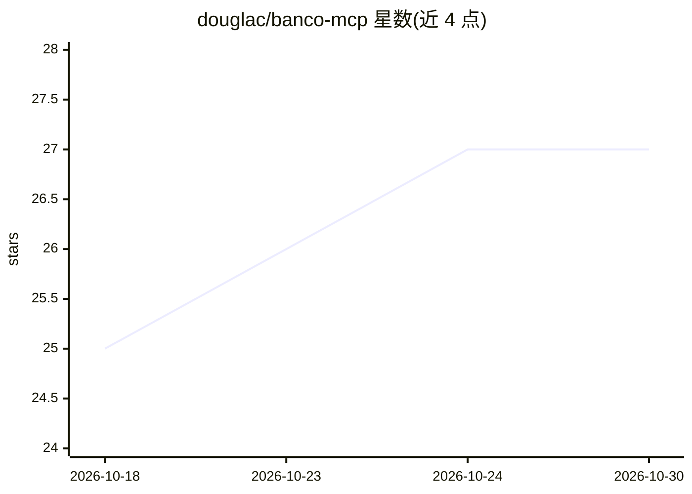

# douglac/banco-mcp

⭐ 27 · MIT · 推送 2026-05-15 · [GitHub](https://github.com/douglac/banco-mcp) · [官网](https://github.com/douglac/banco-mcp) · 个人维护

**连接巴西 30+ 银行 Open Finance 数据到 AI agent 的 MCP 服务**

面向 Claude、Cursor 等 MCP 客户端的巴西 Open Finance 连接器：通过 Pluggy 类聚合通道接入 Itaú、Nubank 等 30+ 家巴西银行与券商，提供 13 个只读工具覆盖余额、流水、信用卡账单、投资组合与贷款查询。访问经 magic-link 与 Open Finance 同意流程，数据保留 30 天，声明符合 LGPD。服务端为托管专有软件（按银行数量订阅付费），本仓库是 MIT 许可的 manifest、文档与 agent skill 包装层。

## 筛选速览

| 维度 | 判定 | 备注 |
|---|---|---|
| AI 角色 | `ai-ecosystem` | LLM/agent 周边工具 |
| 许可风险 | `permissive` | MIT |
| 部署形态 | `library` | 以包/库形式分发 |
| 模型依赖 | — | README 未给出锁定关系 |
| 硬件要求 | — | 无带数字的原话,不猜 |
| 安装摩擦 | `low` | 无编译、无系统依赖或容器化 |
| 成熟度 | — | 结构信号不足 |

## 能力要点

- 13 个只读 Open Finance 工具：余额、流水、账单、投资、贷款
- 支持任意 MCP over HTTP 客户端（Claude、Cursor、VS Code 等）
- 提供 skills.sh 安装的 agent skill，覆盖全部工具的用例编排
- 服务端为托管专有软件，本仓库仅含 MIT 许可的文档与 skill

## 适用场景

- 在 Claude 或 Cursor 中用自然语言查询我的银行流水与余额
- 汇总多银行账户的信用卡账单和投资组合
- 分析自己的月度消费分类情况

## 场景标签

`数据分析` · 领域:效率与自动化

## 证据(README 行号)

> L10: - 💬 **Funciona com qualquer cliente MCP**: Claude Desktop, Cursor, VS Code, Cline, Continue
> L42: Banco MCP funciona em qualquer cliente MCP que suporte **MCP over HTTP**. A URL do servidor é sempre a mesma:
> L44: ```
> L45: https://api.mcp.ai/banco

## 星数曲线



2026-10-18 25 → 2026-10-30 27（+2）


---
*卡片 v1 · prompt 1.4 · 生成 2026-10-26 · 置信度 high · 依据 README sha `c41ef9bdc3da` · [字段定义](../../DATASET.md)*
