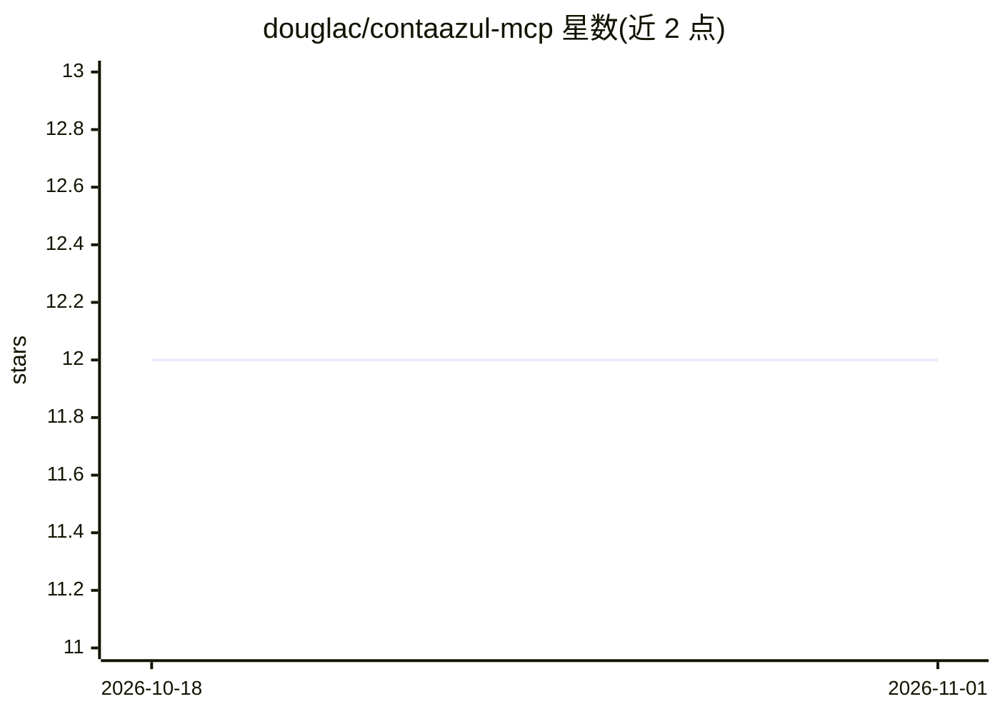

# douglac/contaazul-mcp

⭐ 12 · JavaScript · MIT · 推送 2026-10-05 · [GitHub](https://github.com/douglac/contaazul-mcp) · 个人维护

**把巴西 ERP Conta Azul 接入 AI 客户端的 MCP 连接器**

面向使用 Conta Azul ERP 的巴西企业的 MCP 服务器：通过 MCP over HTTP（api.mcp.ai/contaazul）把 ERP 数据暴露给 Claude Desktop、Cursor、VS Code、ChatGPT 等 40+ 支持 MCP 的客户端。提供 52 个工具覆盖 API v2 的客户、产品、销售、合同、应收应付、分期、对账、收费与电子发票模块；OAuth 2.0 授权，读写兼备（写操作仅在用户明确请求时执行，破坏性操作需确认）。安装为一键深链接连接，无需本地部署；文档为葡萄牙语。

## 筛选速览

| 维度 | 判定 | 备注 |
|---|---|---|
| AI 角色 | `ai-ecosystem` | LLM/agent 周边工具 |
| 许可风险 | `permissive` | MIT |
| 部署形态 | `library` | 以包/库形式分发 |
| 模型依赖 | locked-api |  |
| 硬件要求 | — | 无带数字的原话,不猜 |
| 安装摩擦 | `low` | 无编译、无系统依赖或容器化 |
| 成熟度 | — | 结构信号不足 |

## 能力要点

- 52 个 MCP 工具覆盖 Conta Azul API v2 主要模块
- OAuth 2.0 登录，支持读写操作（写操作需用户明确请求）
- 兼容任何支持 MCP over HTTP 的客户端（40+）
- 支持 boleto/Pix/支付链接生成与 NF-e/NFS-e 查询

## 适用场景

- 在 Claude/Cursor 中用自然语言查询销售额和逾期账款
- 通过 AI 客户端创建客户、销售、合同与财务记录
- 为分期付款生成 boleto 或 Pix 收费

## 场景标签

 · 领域:ERP/财务管理集成

## 证据(README 行号)

> L8: - 💬 **Funciona com qualquer cliente MCP**: Claude Desktop, Cursor, VS Code, Cline, Continue
> L40: Conta Azul MCP funciona em qualquer cliente MCP que suporte **MCP over HTTP**. A URL do servidor é sempre a mesma:

## 星数曲线

2026-10-18 12 → 2026-11-01 12（+0）

---
*卡片 v1 · prompt 1.4 · 生成 2026-11-01 · 置信度 mid · 依据 README sha `efdaf5c1c414` · [字段定义](../../DATASET.md)*
