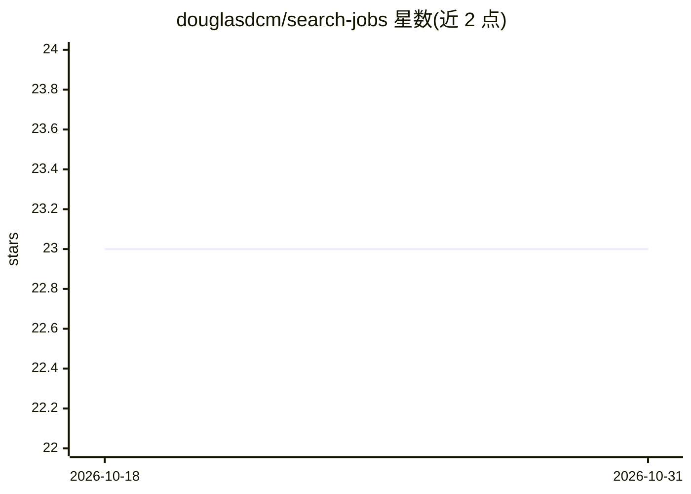

# douglasdcm/search-jobs

⭐ 23 · Python · GPL-3.0 · 推送 2026-10-11 · [GitHub](https://github.com/douglasdcm/search-jobs) · [官网](https://vagaspramim.onrender.com) · 个人维护

**抓取企业招聘网站职位并与求职者简历匹配的工具**

用通用爬虫从不同公司的公开招聘网站抓取职位信息，存入数据库，并支持将用户简历与抓取到的职位进行比较，以筛选出与个人相关的岗位。项目可按简单步骤添加新的目标公司；运行方式为 Docker Compose 容器或手动启动 Flask 服务器，本地访问 localhost:5001，另提供 CLI 初始化数据库等命令。README 为葡萄牙语，面向求职者与贡献者。

## 筛选速览

| 维度 | 判定 | 备注 |
|---|---|---|
| AI 角色 | `ai-enhanced` | 去掉 AI 部分产品仍成立 |
| 许可风险 | `viral` | GPL-3.0 |
| 部署形态 | `self-host` | docker 或自建部署 |
| 模型依赖 | — | README 未给出锁定关系 |
| 硬件要求 | — | 无带数字的原话,不猜 |
| 安装摩擦 | `low` | 无编译、无系统依赖或容器化 |
| 成熟度 | — | 结构信号不足 |

## 能力要点

- 通用爬虫抓取多家公司公开招聘网站的职位
- 简历与职位比较以筛选相关岗位
- 可通过配置步骤添加新的目标公司
- 提供 Docker Compose 容器运行方式与 CLI

## 适用场景

- 集中查看多家公司官网发布的职位
- 用自己的简历匹配并筛选相关职位
- 按模板添加感兴趣的公司作为抓取目标

## 场景标签

`网页抓取` · 领域:效率与自动化

## 证据(README 行号)

> L2: Este projeto utiliza um crawler genérico para buscar por vagas em diferentes empresas e lhe permite comparar o seu c
> L21: Instale o Docker e Docker Compose, faça o build da imagem Docker e suba os containers. Você pode usar o utilitário 

## 星数曲线

2026-10-18 23 → 2026-10-31 23（+0）

---
*卡片 v1 · prompt 1.4 · 生成 2026-10-27 · 置信度 low · 依据 README sha `31634124517e` · [字段定义](../../DATASET.md)*
