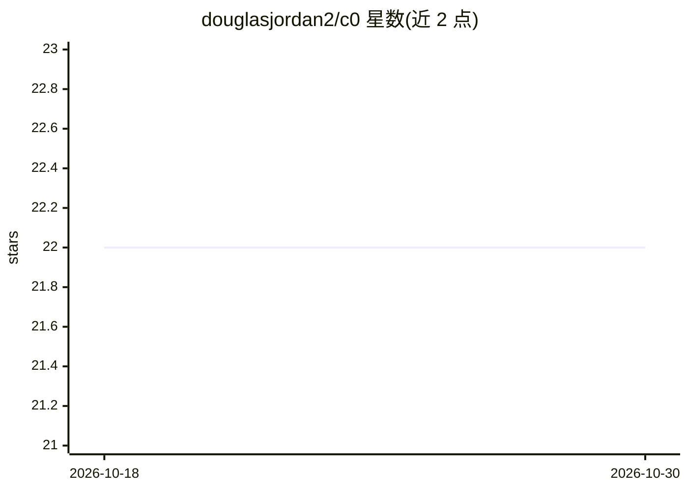

# douglasjordan2/c0

⭐ 22 · Rust · MIT · 推送 2026-10-18 · [GitHub](https://github.com/douglasjordan2/c0) · 个人维护

**给 LLM 用的外置记忆：双时态知识图谱+混合检索**

Rust 编写的 LLM 外置记忆层：把知识存为 Neo4j 中的 Concept 节点与类型化关系，而非文本块；检索走精确匹配→BM25→混合（RRF 融合）三级级联。每个概念带记录时间与有效时间双时间戳，支持 as-of 查询、supersede 演进与带因果链的失效。未命中查询进入反思循环，由 LLM 分类后自动提交新概念。内置 c0 bench/c0 eval 基准。默认 Ollama 本地嵌入与分类，可选 Claude。核心检索路径 CPU-only 可运行。

## 筛选速览

| 维度 | 判定 | 备注 |
|---|---|---|
| AI 角色 | `ai-ecosystem` | LLM/agent 周边工具 |
| 许可风险 | `permissive` | MIT |
| 部署形态 | `self-host` | docker 或自建部署 |
| 模型依赖 | local-ok | 支持本地模型 |
| 硬件要求 | — | 无带数字的原话,不猜 |
| 安装摩擦 | `low` | 无编译、无系统依赖或容器化 |
| 成熟度 | — | 结构信号不足 |

## 能力要点

- Neo4j 知识图谱存储，双时态（transaction/valid time）与 as-of 查询
- 精确→BM25→向量混合检索，RRF 融合
- 反思循环自动分类并提交未命中概念填补记忆缺口
- 内置 c0 bench / c0 eval 基准与检索评测（recall@k、MRR）

## 适用场景

- 为无状态的 LLM 会话提供持久可修正的记忆层
- 纠正模型过时训练数据（知识 patch 机制）
- 对知识做时点查询与带审计痕迹的更新失效

## 场景标签

`Agent 记忆` `知识图谱` · 领域:Agent 开发

## 证据(README 行号)

> L3: **An external memory for LLMs** — a bi-temporal knowledge graph with hybrid (keyword + vector) retrieval and a self-
> L104: - **Ollama** for local embeddings *and* the reflection loop's classifier (defaults: `nomic-embed-text` for embeddi

## 星数曲线

2026-10-18 22 → 2026-10-30 22（+0）

---
*卡片 v1 · prompt 1.4 · 生成 2026-10-27 · 置信度 high · 依据 README sha `95ad8c1bea67` · [字段定义](../../DATASET.md)*
