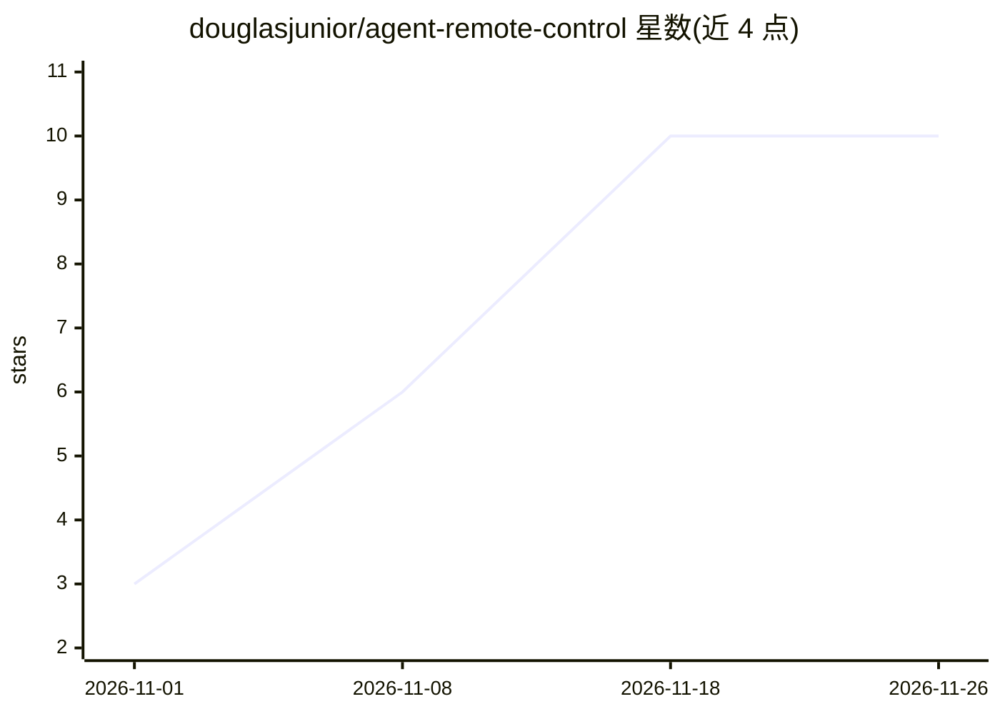

# douglasjunior/agent-remote-control

⭐ 10 · TypeScript · MIT · 推送 2026-11-22 · [GitHub](https://github.com/douglasjunior/agent-remote-control) · 个人维护

**远程指挥多个 AI 编码代理协作写码并开 PR 的自托管服务**

基于 NestJS 与 TypeScript 的自托管服务，通过 Discord 机器人与 Web 界面驱动本机上已登录的编码代理 CLI。CEO 角色的代理将用户消息拆解并委派给 Product Owner、Tech Lead、Developer、Code Reviewer、QA、Git Ops 等角色代理，每个任务有看板与历史记录，最终生成并提交 pull request。支持 WebRTC 端到端加密远程访问，无需开放端口或 VPN。前提是本机需安装并登录至少一个受支持的代理 CLI；README 警告代理以完全自主权限运行，建议置于私有服务器或专用机器/容器。

## 筛选速览

| 维度 | 判定 | 备注 |
|---|---|---|
| AI 角色 | `ai-ecosystem` | LLM/agent 周边工具 |
| 许可风险 | `permissive` | MIT |
| 部署形态 | `self-host` | docker 或自建部署 |
| 模型依赖 | locked-api |  |
| 硬件要求 | — | 无带数字的原话,不猜 |
| 安装摩擦 | `low` | 无编译、无系统依赖或容器化 |
| 成熟度 | — | 结构信号不足 |

## 能力要点

- 六个角色代理（CEO/PO/Tech Lead/Developer/Reviewer/Git Ops 等）分工协作
- 开箱支持五个代理 CLI，经 Agent Client Protocol（ACP）接入，可用 /agent 切换
- WebRTC 端到端加密远程访问，默认关闭，令牌与证书指纹校验
- 每个会话带任务看板（树/看板视图）与完整变更历史，会话可跨重启恢复

## 适用场景

- 用手机在浏览器或 Discord 上远程给本机编码代理派活
- 让多角色代理团队完成从需求拆解到 PR 的完整流程
- 在私有服务器上自托管，复用已有的代理订阅而不加托管中间人

## 场景标签

`编码 Agent` `多智能体` · 领域:Agent 开发

## 证据(README 行号)

> L26: AI coding agents are incredible, as long as you are sitting in front of the terminal that runs them. **Agent Remote
> L30: - 👥 **A team, not a single agent.** A CEO agent talks to you, scopes the request and delegates to a Product Owner, 
> L132: |Agent|Command on `PATH`|How it connects|Setup|

## 星数曲线

2026-11-01 3 → 2026-11-26 10（+7）

---
*卡片 v1 · prompt 1.4 · 生成 2026-11-19 · 置信度 mid · 依据 README sha `fb9225a86bcc` · [字段定义](../../DATASET.md)*
