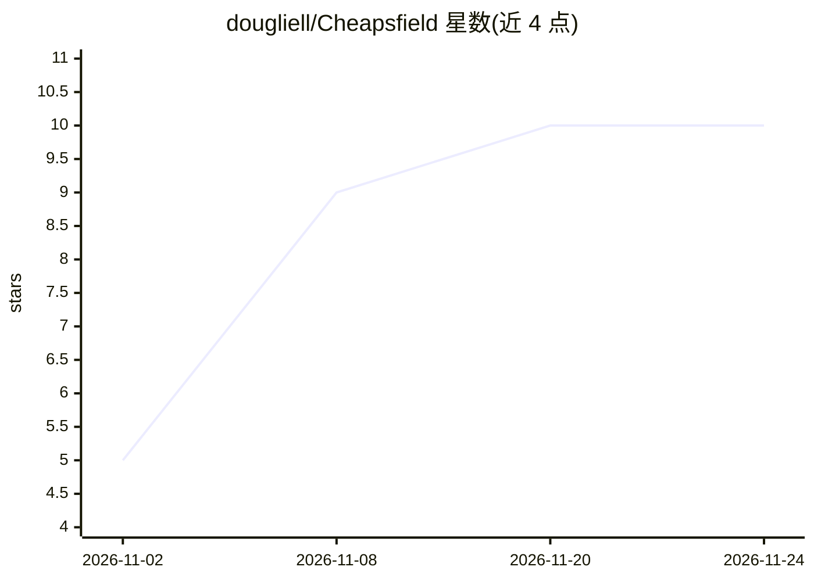

# dougliell/Cheapsfield

⭐ 10 · TypeScript · Apache-2.0 · 推送 2026-10-29 · [GitHub](https://github.com/dougliell/Cheapsfield) · 个人维护

**面向广告/建筑创作者的本地生成式图像视频桌面工作室**

Windows 桌面应用，内置 ComfyUI 以无头子进程方式本地运行，通过 Comfy SDK 提交工作流，全部生成在用户 GPU 上完成，不上传、无 API key。提供两类交互：单屏 Apps（如 Shot Director、True Line、Character Swap、Motion Transfer、Video from References 等约 15 个）与节点画布 Flow，输出 PNG 内嵌配方可一键重建。工作流仅用 ComfyUI 核心节点，模型按文件名匹配，全部为开放权重。架构上为 Tauri 2 + React，项目数据存 SQLite。

## 筛选速览

| 维度 | 判定 | 备注 |
|---|---|---|
| AI 角色 | `ai-native` | 本体是模型或模型工具 |
| 许可风险 | `permissive` | Apache-2.0 |
| 部署形态 | `desktop` | 安装包/桌面程序 |
| 模型依赖 | — | README 未给出锁定关系 |
| 硬件要求 | `gpu-8g` | |
| 安装摩擦 | `low` | 无编译、无系统依赖或容器化 |
| 成熟度 | — | 结构信号不足 |

## 能力要点

- 约 15 个单屏 Apps 与节点画布 Flow 两种工作方式
- 生成全部本地进行：内置 ComfyUI 无头运行，仅核心节点、开放权重模型
- Character Swap/Motion Transfer 等视频能力支持原生音频
- 输出 PNG 内嵌生成配方，可一键重建节点

## 适用场景

- 把产品草图或 3D 渲染图变成成品广告图与短视频
- 建筑草图、户型图生成效果图与日转夜视图
- 用参考照片创建虚拟数字人并替换视频中的人物

## 场景标签

`图像生成` `视频生成` · 领域:内容生成

## 证据(README 行号)

> L3: **A 100% local, 100% open-weights creative studio for product, advertising and architecture visuals, built on ComfyU
> L11: Every image and video is generated **on your own GPU, by open-weights models you download once**. Nothing is sent t

## 星数曲线

2026-11-02 5 → 2026-11-24 10（+5）

---
*卡片 v1 · prompt 1.4 · 生成 2026-11-20 · 置信度 mid · 依据 README sha `b9a8742fedec` · [字段定义](../../DATASET.md)*
