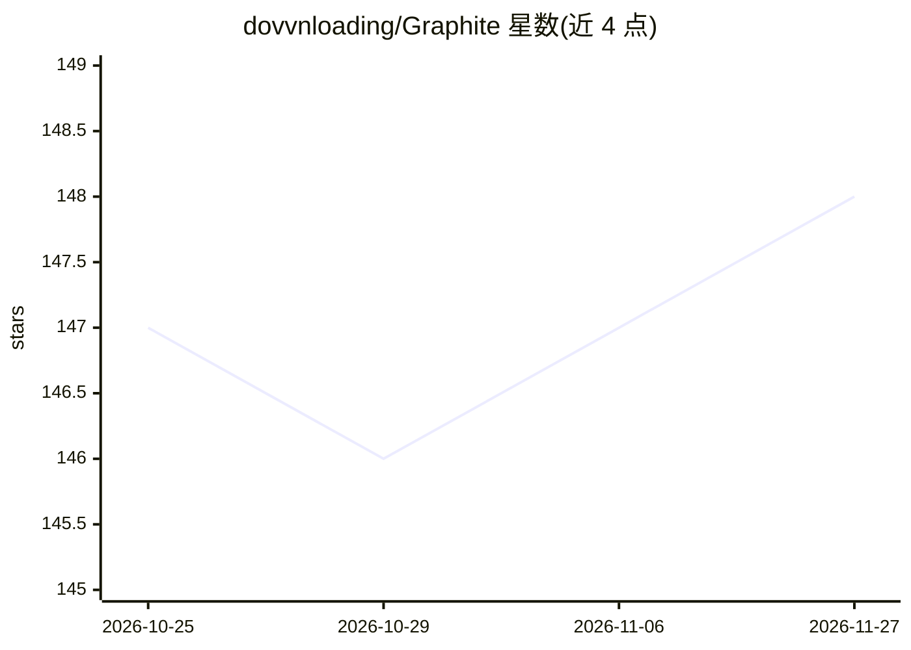

# dovvnloading/Graphite

⭐ 148 · Python · MIT · 推送 2026-11-16 · [GitHub](https://github.com/dovvnloading/Graphite) · [官网](https://github.com/dovvnloading/Graphlink) · 个人维护

**节点画布式本地 LLM 对话工作区，供思考与创作**

基于 Python 与 PySide6 的桌面应用，把传统线性聊天转为无限画布上的节点图：每个提示与回复是一个可拖拽节点，可从任意节点分叉探索不同推理路径。支持通过 Ollama 完全本地运行，也可切换到 OpenAI 兼容远程 API；内置摘要、解释与 matplotlib 图表生成等 AI 任务代理，会话以 JSON 序列化存入本地 SQLite 数据库。需预装 Ollama 并拉取默认模型，无打包发行版，从源码运行。

## 筛选速览

| 维度 | 判定 | 备注 |
|---|---|---|
| AI 角色 | `ai-native` | 本体是模型或模型工具 |
| 许可风险 | `permissive` | MIT |
| 部署形态 | `library` | 以包/库形式分发 |
| 模型依赖 | local-ok | 支持本地模型 |
| 硬件要求 | — | 无带数字的原话,不猜 |
| 安装摩擦 | `low` | 无编译、无系统依赖或容器化 |
| 成熟度 | — | 结构信号不足 |

## 能力要点

- 无限画布节点图对话，任意节点分叉非线性推理路径
- Ollama 本地推理与 OpenAI 兼容远程 API 双模式
- AI 生成摘要、解释与 matplotlib 图表（柱/折/饼/直方/桑基）
- Frames/Notes/导航钉等组织工具，会话存本地 SQLite

## 适用场景

- 围绕复杂问题做分支式推理与思路整理
- 隐私敏感场景下完全离线使用本地大模型
- 用 AI 对节点内容生成摘要或数据图表

## 场景标签

`AI 助手` · 领域:对话与助手

## 证据(README 行号)

> L9: Graphite is an advanced desktop environment for human–AI collaboration. It transforms traditional chat into a visual
> L11: Built with Python and PySide6, Graphite integrates Ollama, OpenAI, Gemini, Anthropic, and Groq models to provide a 
> L75: - **`api_provider.py`**: An abstraction layer responsible for routing requests to the appropriate model provider. I

## 星数曲线

2026-10-25 147 → 2026-11-27 148（+1）

---
*卡片 v1 · prompt 1.4 · 生成 2026-11-27 · 置信度 high · 依据 README sha `12c5b116006d` · [字段定义](../../DATASET.md)*
