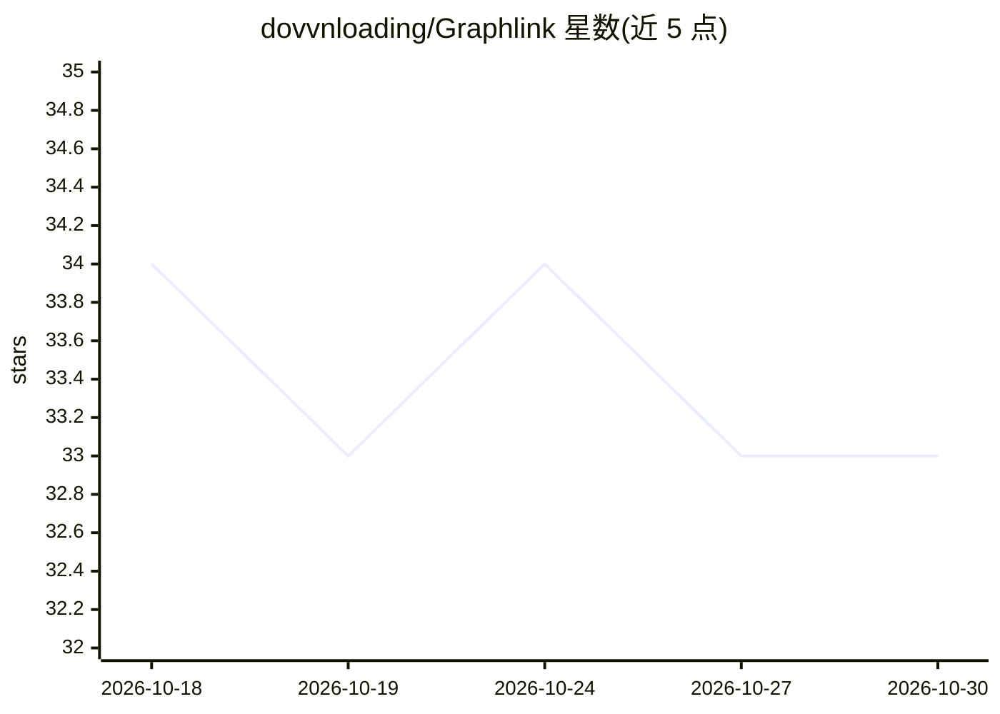

# dovvnloading/Graphlink

⭐ 33 · Python · MIT · 推送 2026-10-24 · [GitHub](https://github.com/dovvnloading/Graphlink) · 个人维护

**本地优先的图结构 AI 工作台：画布上分支对话并运行多步任务**

以可视化画布取代线性聊天窗口的桌面 AI 工作台：对话、代码生成、网络调研、起草与执行各自作为节点，可按分支指定模型与上下文。后端为 Python（FastAPI），前端为 Vite/React/TypeScript，经 pywebview 以单一原生窗口运行，数据存于本地 SQLite。内置 Builder agent 按预算分步执行多步任务且全程可撤销；模型后端支持本地（Ollama、llama.cpp/GGUF）与云端 API（OpenAI 兼容、Anthropic Claude、Google Gemini）。要求 Python 3.12+、Node.js 22+，Windows 为主要开发目标。

## 筛选速览

| 维度 | 判定 | 备注 |
|---|---|---|
| AI 角色 | `ai-native` | 本体是模型或模型工具 |
| 许可风险 | `permissive` | MIT |
| 部署形态 | `library` | 以包/库形式分发 |
| 模型依赖 | local-ok | 支持本地模型 |
| 硬件要求 | — | 无带数字的原话,不猜 |
| 安装摩擦 | `low` | 无编译、无系统依赖或容器化 |
| 成熟度 | — | 结构信号不足 |

## 能力要点

- 可视化分支画布，15 种节点类型（Chat/Code/Web Research/Chart 等）
- Builder agent：先出计划清单，按步骤/令牌/时间硬预算执行，可整体撤销
- 本地模型运行时（Ollama、llama.cpp GGUF）与云端 API 三种后端可切换
- 插件节点体系：网络调研、虚拟环境运行 Python、GitHub 仓库感知编辑，含插件 SDK

## 适用场景

- 把一个问题分支成多条并行的调研/实验线，各自用不同模型
- 把多步任务交给带预算和监督级别的 Builder agent 执行
- 在本地（Ollama/llama.cpp）运行模型，数据不出本机

## 场景标签

`AI 助手` `代码生成` · 领域:编码与开发

## 证据(README 行号)

> L11: **A local-first, graph-based AI workspace for branching reasoning, tool use, and multi-provider workflows.**
> L13: Graphlink replaces the linear chat window with a visual canvas of connected nodes. Instead of forcing every interac
> L15: It is built with a Python (FastAPI) backend and a Vite/React/TypeScript single-page app, launched as one native des

## 星数曲线

2026-10-18 34 → 2026-10-30 33（-1）

---
*卡片 v1 · prompt 1.4 · 生成 2026-10-25 · 置信度 mid · 依据 README sha `3b5277c915cf` · [字段定义](../../DATASET.md)*
