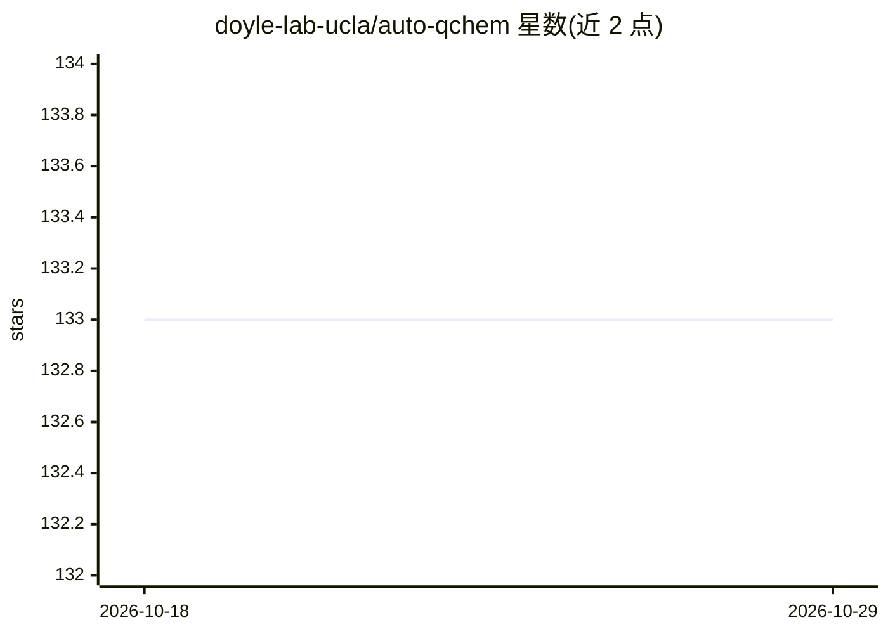

# doyle-lab-ucla/auto-qchem

⭐ 133 · Python · GPL-3.0 · 推送 2026-01-14 · [GitHub](https://github.com/doyle-lab-ucla/auto-qchem) · [官网](https://doyle-lab-ucla.github.io/auto-qchem/) · 组织维护

**有机分子 DFT 计算自动化生成与存储的工作流**

由 UCLA Doyle 实验室维护的自动化工作流，用于生成并存储有机分子的 DFT（密度泛函理论）计算结果及描述符，供机器学习使用。通过集群调度器管理计算任务：内置支持 Slurm（Princeton）与 SGE/UGE（UCLA）两类调度器；外部用户若使用其他调度器需自行修改管理脚本，可能需要大量改动。提供安装说明、数据库访问与示例 notebook 链接，并附发表论文。

## 筛选速览

| 维度 | 判定 | 备注 |
|---|---|---|
| AI 角色 | `ai-native` | 本体是模型或模型工具 |
| 许可风险 | `viral` | GPL-3.0 |
| 部署形态 | `None` |  |
| 模型依赖 | — | README 未给出锁定关系 |
| 硬件要求 | — | 无带数字的原话,不猜 |
| 安装摩擦 | `low` | 无编译、无系统依赖或容器化 |
| 成熟度 | — | 结构信号不足 |

## 能力要点

- 自动生成并存储有机分子的 DFT 计算与描述符
- 内置 Slurm 与 SGE/UGE 两类集群调度器适配
- 提供数据库、示例 notebook 与发表论文链接

## 适用场景

- 批量生成有机分子 DFT 计算数据用于机器学习
- 在 Slurm 或 SGE 调度的计算集群上自动化运行量化计算
- 获取分子描述符构建分子数据集

## 场景标签

`工作流自动化` · 领域:效率与自动化

## 证据(README 行号)

> L20: Auto-QChem currently supports Slurm scheduler at Princeton via slurm_manager.py; and SGE/UGE-type scheduler at UCLA
> L24: If you are an external user and your computational cluster uses other schedulers, you can still modify either .py f

## 星数曲线

2026-10-18 133 → 2026-10-29 133（+0）

---
*卡片 v1 · prompt 1.4 · 生成 2026-10-22 · 置信度 mid · 依据 README sha `bc25659174ed` · [字段定义](../../DATASET.md)*
