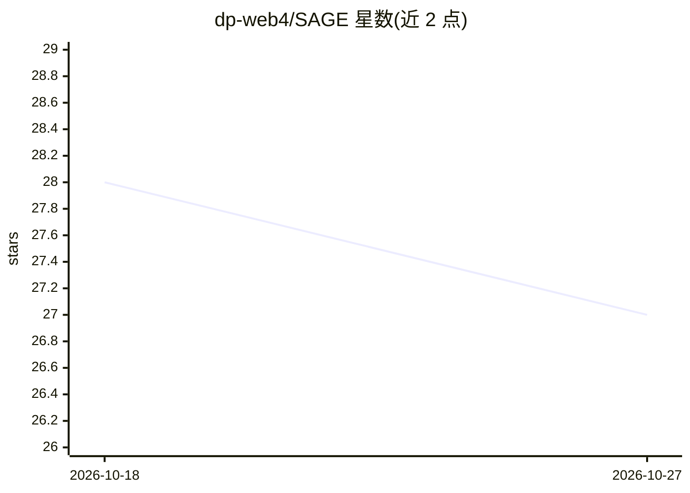

# dp-web4/SAGE

⭐ 27 · Python · AGPL-3.0 · 推送 2026-10-26 · [GitHub](https://github.com/dp-web4/SAGE) · 个人维护

**将冻结 LLM 包裹于持久身份与治理层的认知架构研究环境**

研究型项目：在固定权重的语言模型外层构建持久身份、记忆、注意/代谢状态、工具接口与治理回路，考察智能体能否跨会话积累经验与程序，而非每次提示从零开始。公共仓库提供内核架构与研究记录，含 SNARC 显著性维度、WAKE/FOCUS/REST 等代谢模式、多路径记忆与 IRP 插件框架；活跃能力研究在私有仓库进行。README 明确区分已测量、部分实现与愿景内容，自称研究阶段而非成品，本地模型 ARC-AGI-3 延续实验最高得 0.14 分。

## 筛选速览

| 维度 | 判定 | 备注 |
|---|---|---|
| AI 角色 | `ai-ecosystem` | LLM/agent 周边工具 |
| 许可风险 | `viral` | AGPL-3.0 |
| 部署形态 | `None` |  |
| 模型依赖 | — | README 未给出锁定关系 |
| 硬件要求 | — | 无带数字的原话,不猜 |
| 安装摩擦 | `low` | 无编译、无系统依赖或容器化 |
| 成熟度 | `idea` | |

## 能力要点

- 持久身份与信任状态跨会话、跨模型变更保留
- SNARC 显著性维度与 WAKE/FOCUS/REST/DREAM/CRISIS 代谢模式
- 多路径记忆：近端上下文、显著度门控经验、逐字记录、跨会话整合
- 治理定位于行动边界，能力与授权分离，当前为 A1 协作且防篡改级

## 适用场景

- 研究持久记忆与治理结构对智能体跨会话行为的影响
- 在边缘设备上长期运行本地智能体并积累经验
- 考察身份/治理底座对执行实体自身的价值

## 场景标签

`Agent 记忆` · 领域:Agent 开发

## 证据(README 行号)

> L5: SAGE is the research environment for turning a frozen language-model substrate into a longer-lived agent that can ac
> L9: SAGE is research-stage and deliberately explicit about what is measured, what is implemented but thinly exercised, a

## 星数曲线

2026-10-18 28 → 2026-10-27 27（-1）

---
*卡片 v1 · prompt 1.4 · 生成 2026-10-26 · 置信度 high · 依据 README sha `2d349d9a0df1` · [字段定义](../../DATASET.md)*
