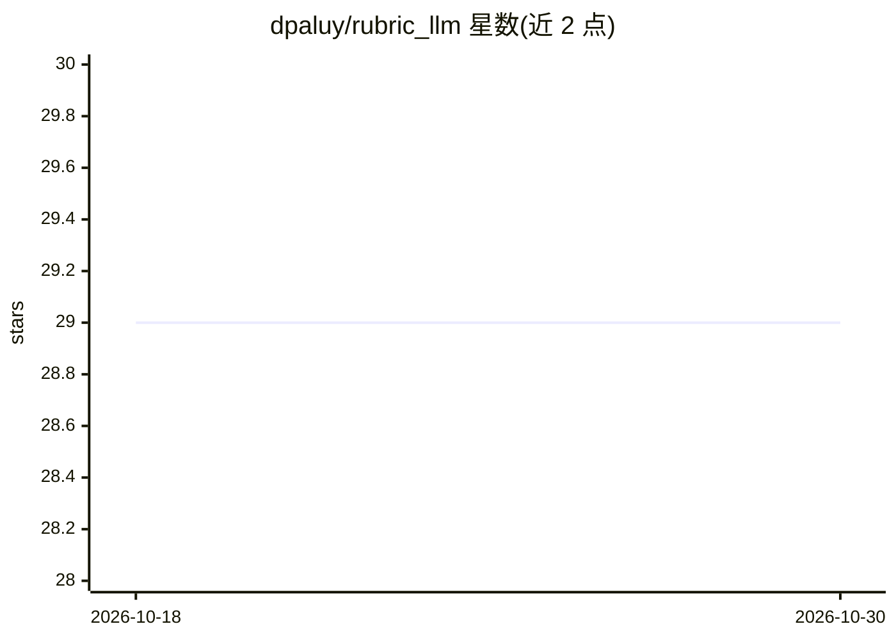

# dpaluy/rubric_llm

⭐ 29 · Ruby · MIT · 推送 2026-10-14 · [GitHub](https://github.com/dpaluy/rubric_llm) · [官网](https://majesticlabs.dev/open-source) · 个人维护

**面向 Ruby 的轻量 LLM 评测框架，含 LLM-as-Judge 指标与统计 A/B 对比**

受 DeepEval 启发、基于 RubyLLM 构建的 Ruby gem，提供 provider 无关的 LLM 输出评测：6 种 LLM-as-Judge 指标（正确性/相关性/事实性/忠实度/上下文精度与召回，各返回 0.0–1.0 分）、纯数学检索指标（precision@k、recall@k、MRR、NDCG）、批评测与基于配对 t 检验的模型 A/B 对比（Holm-Bonferroni 校正）。集成 Minitest/RSpec 断言，支持自定义指标子类。无 Rails、无数据库迁移，依赖 RubyLLM >=2.1.1 与 Ruby 3.4+。README 明确说明 LLM-as-Judge 的固有失败模式及缓解措施（跨模型裁判等）。

## 筛选速览

| 维度 | 判定 | 备注 |
|---|---|---|
| AI 角色 | `ai-ecosystem` | LLM/agent 周边工具 |
| 许可风险 | `permissive` | MIT |
| 部署形态 | `None` |  |
| 模型依赖 | — | README 未给出锁定关系 |
| 硬件要求 | — | 无带数字的原话,不猜 |
| 安装摩擦 | `low` | 无编译、无系统依赖或容器化 |
| 成熟度 | — | 结构信号不足 |

## 能力要点

- 6 种 LLM-as-Judge 指标 + 纯数学检索指标（无需 LLM 调用）
- 配对 t 检验的统计 A/B 模型对比，含多重比较校正
- Minitest/RSpec 测试框架集成与自定义指标子类
- 全部配置支持 RUBRIC_* 环境变量，含重试与并发控制

## 适用场景

- 为 Ruby LLM 应用编写评测与回归测试断言
- 统计显著性地对比两个模型在同一数据集上的表现
- 评测 RAG 检索质量（faithfulness、context precision/recall、NDCG）

## 场景标签

`模型评测` · 领域:评测与运维

## 证据(README 行号)

> L3: Lightweight LLM evaluation framework for Ruby, inspired by DeepEval, powered by RubyLLM.
> L9: Provider-agnostic evaluation with pluggable metrics, statistical A/B comparison, and test framework integration: no 
> L146: ## Metrics

## 星数曲线

2026-10-18 29 → 2026-10-30 29（+0）

---
*卡片 v1 · prompt 1.4 · 生成 2026-10-26 · 置信度 high · 依据 README sha `834326610848` · [字段定义](../../DATASET.md)*
