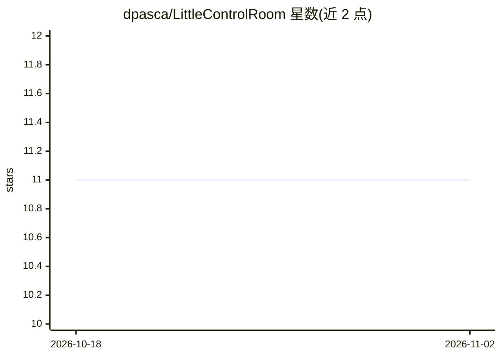

# dpasca/LittleControlRoom

⭐ 11 · Go · MIT · 推送 2026-10-30 · [GitHub](https://github.com/dpasca/LittleControlRoom) · 个人维护

**统一管理多个仓库中编码 agent 会话的终端仪表盘**

面向在多个本地仓库中并行使用编码 agent 的开发者：LCR 发现并聚合 Codex、Claude Code、OpenCode 的本地会话，在一个 TUI 中展示各项目状态，支持一键恢复会话、把 TODO 转入独立 worktree 并启动 agent、diff/commit/push、端口冲突检测与孤儿进程管理。内置 agent 可通过 MCP 服务器回查 LCR 状态并提交待确认操作。后台摘要类小任务可配置 OpenAI/DeepSeek/OpenRouter 等远端模型或 MLX/Ollama 本地推理。仅支持 macOS/Linux，Windows 不支持；需已有对应 agent CLI。

## 筛选速览

| 维度 | 判定 | 备注 |
|---|---|---|
| AI 角色 | `ai-ecosystem` | LLM/agent 周边工具 |
| 许可风险 | `permissive` | MIT |
| 部署形态 | `desktop` | 安装包/桌面程序 |
| 模型依赖 | local-ok | 支持本地模型 |
| 硬件要求 | — | 无带数字的原话,不猜 |
| 安装摩擦 | `medium` | 含编译或系统依赖之一 |
| 成熟度 | `idea` | |

## 能力要点

- 跨仓库发现并聚合 Codex/Claude Code/OpenCode 会话，一键恢复
- TODO 一键转入独立 git worktree 并以 agent 启动任务
- 为内嵌 agent 提供 lcr_runtime MCP 服务器，支持查询与待确认操作
- 后台推理可选 OpenAI/DeepSeek/OpenRouter 或 MLX/Ollama 本地后端

## 适用场景

- 同时在多个仓库跑编码 agent，需要一处查看全部进度
- 把项目 TODO 派发给 agent 在独立 worktree 中并行执行
- 清理多项目开发时的端口冲突与孤儿进程

## 场景标签

 · 领域:开发者工具/AI 工作流管理

## 证据(README 行号)

> L14: > **LCR does not replace your coding agents.**
> L233: **Embedded session providers** — the agents that write code. Codex, OpenCode, and
> L238: **Background inference** — the manager model described above, plus Chat, which has

## 星数曲线

2026-10-18 11 → 2026-11-02 11（+0）

---
*卡片 v1 · prompt 1.4 · 生成 2026-11-02 · 置信度 high · 依据 README sha `feab36d02cdd` · [字段定义](../../DATASET.md)*
