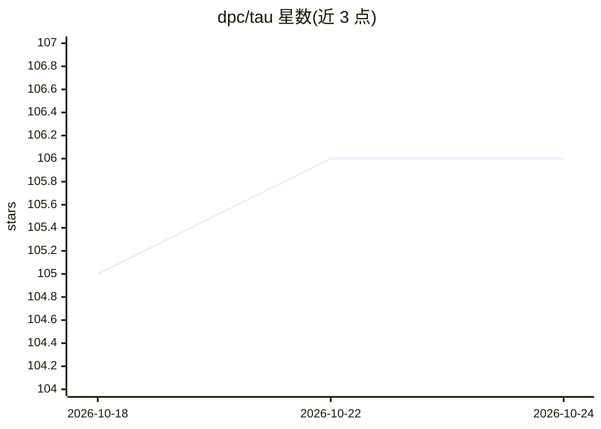

# dpc/tau

⭐ 106 · Rust · MPL-2.0 · 推送 2026-10-19 · [GitHub](https://github.com/dpc/tau) · [官网](https://tau-agent.dev/) · 个人维护

**面向 Unix 命令行用户的极简本地 coding agent**

Tau 是一个 Unix 风格的命令行 coding agent，面向希望在本地获得控制权、使用简单进程边界并将工具自然融入命令行环境的开发者。项目以 Radicle 作为主要的分布式代码协作平台，GitHub 仓库仅为只读镜像，最新版本与更多信息在其 Radicle 站点。README 可见部分仅含简介与贡献说明，未展示具体模型接入方式、安装命令或工具机制。

## 筛选速览

| 维度 | 判定 | 备注 |
|---|---|---|
| AI 角色 | `ai-native` | 本体是模型或模型工具 |
| 许可风险 | `permissive` | MPL-2.0 |
| 部署形态 | `None` |  |
| 模型依赖 | — | README 未给出锁定关系 |
| 硬件要求 | — | 无带数字的原话,不猜 |
| 安装摩擦 | `low` | 无编译、无系统依赖或容器化 |
| 成熟度 | — | 结构信号不足 |

## 能力要点

- Unix-first 设计：本地控制与简单进程边界
- 面向命令行环境运行
- 以 Radicle 为主要协作平台，GitHub 为只读镜像

## 适用场景

- 在命令行环境中使用 coding agent 辅助编码
- 偏好本地控制与 Unix 工具链的开发者使用

## 场景标签

`编码 Agent` · 领域:编码与开发

## 证据(README 行号)

> L3: # Tau coding agent
> L5: Tau is a minimal Unix-first coding agent for people who want local control, simple process boundaries, and tooling t

## 星数曲线

2026-10-18 105 → 2026-10-24 106（+1）

---
*卡片 v1 · prompt 1.4 · 生成 2026-10-23 · 置信度 low · 依据 README sha `d1dccc4644e5` · [字段定义](../../DATASET.md)*
