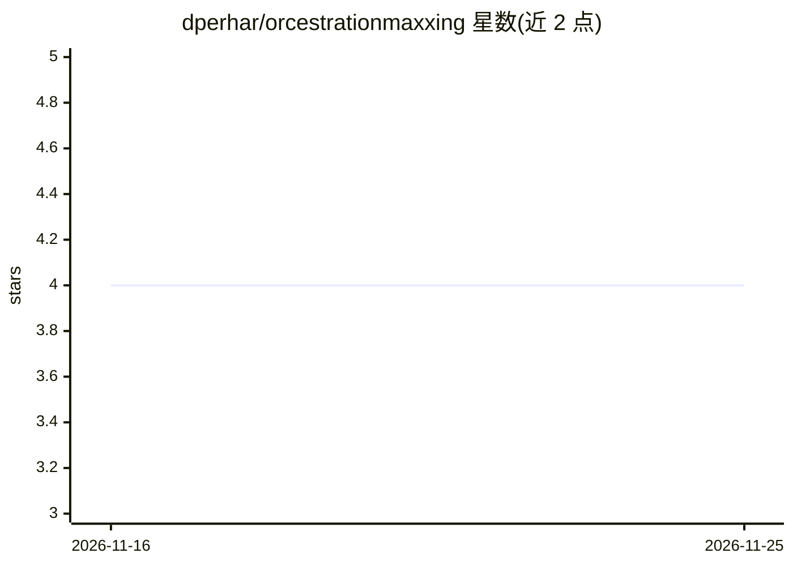

# dperhar/orcestrationmaxxing

⭐ 4 · Python · MIT · 推送 2026-11-15 · [GitHub](https://github.com/dperhar/orcestrationmaxxing) · 个人维护

**为使用 Orca+OMP 的开发者提供多 agent 分层编排工具链**

在 Orca（git worktree 编排）与 OMP（agent harness）之上构建的多 agent 工作流：1 个协调者聊天负责规划、拆票、评审与合并（扩展机制禁止其写代码），N 个 worker 在各自 git worktree 中并行实现、测试、提交；每次合并前须经 verify（测试）、judge（代码评审）、board（范围审查）三道记录在案的关卡。状态保存在 SQLite 注册表与 git 中，压缩后重注入角色，崩溃后可 recover。要求 macOS、Python 3.9+、Bun，仅支持 macOS 路径。

## 筛选速览

| 维度 | 判定 | 备注 |
|---|---|---|
| AI 角色 | `ai-ecosystem` | LLM/agent 周边工具 |
| 许可风险 | `permissive` | MIT |
| 部署形态 | `library` | 以包/库形式分发 |
| 模型依赖 | — | README 未给出锁定关系 |
| 硬件要求 | — | 无带数字的原话,不猜 |
| 安装摩擦 | `low` | 无编译、无系统依赖或容器化 |
| 成熟度 | — | 结构信号不足 |

## 能力要点

- 1 协调者 + N 并行 worker 的分层 agent 结构，工具强制角色边界
- 合并前 verify/judge/board 三道记录在案的强制关卡
- SQLite 注册表记录任务、尝试与裁决，支持 recover
- worktree 池复用与 sparse worktree 减少磁盘与重装开销

## 适用场景

- 让多个 agent 在独立 worktree 中并行处理项目任务单
- 对 agent 合并到 main 的代码设置自动化评审关卡
- 长时间运行的多 agent 会话中保留任务状态以便崩溃恢复

## 场景标签

`多智能体` `Agent 框架` · 领域:Agent 开发

## 证据(README 行号)

> L21: Built on Orca (worktrees, terminals, orchestration messages) and OMP (the agent harness, its extensions, and subage
> L11: - **1 coordinator** plans, splits work into tickets, reviews, merges, and keeps the docs current. It can't write co

## 星数曲线

2026-11-16 4 → 2026-11-25 4（+0）

---
*卡片 v1 · prompt 1.4 · 生成 2026-11-21 · 置信度 high · 依据 README sha `13cb1a7ad27f` · [字段定义](../../DATASET.md)*
