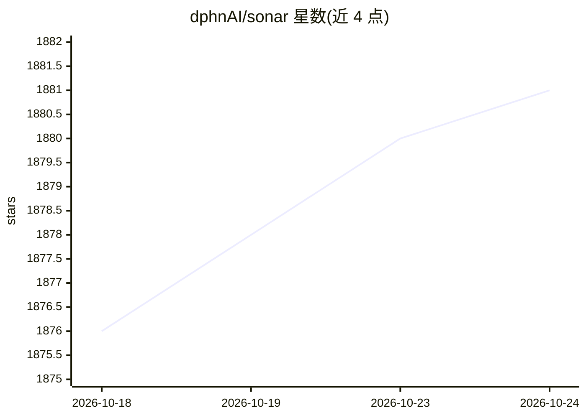

# dphnAI/sonar

⭐ 1,881 · Python · AGPL-3.0 · 推送 2026-10-23 · [GitHub](https://github.com/dphnAI/sonar) · [官网](https://sonar.dphn.ai) · 组织维护

**基于 vLLM 的大规模 LLM 推理引擎，面向生产部署**

面向 Hugging Face 兼容语言与多模态模型的推理引擎，基于 vLLM 构建，在 vLLM 之上增加模型与量化格式、采样方法、内核、平台与部署特性。提供连续批处理、分页 KV-cache 管理、张量/流水线/数据/专家并行、推测解码、LoRA 服务与结构化输出，暴露 OpenAI 兼容等 API。为 Dolphin Inference Network 与 PygmalionAI 承载生产负载。通过 curl 安装脚本安装，支持 NVIDIA CUDA、AMD ROCm、Intel XPU、CPU、Apple silicon、TPU 与 Docker。

## 筛选速览

| 维度 | 判定 | 备注 |
|---|---|---|
| AI 角色 | `ai-ecosystem` | LLM/agent 周边工具 |
| 许可风险 | `viral` | AGPL-3.0 |
| 部署形态 | `library` | 以包/库形式分发 |
| 模型依赖 | — | README 未给出锁定关系 |
| 硬件要求 | — | 无带数字的原话,不猜 |
| 安装摩擦 | `medium` | 含编译或系统依赖之一 |
| 成熟度 | — | 结构信号不足 |

## 能力要点

- 基于 vLLM，扩展模型/量化格式、内核、平台与部署特性
- 连续批处理、分页 KV-cache、前缀缓存默认启用
- 张量/流水线/数据/专家并行与多节点多进程（无 Ray 集群）
- 提供 OpenAI/Anthropic/转录/重排等多套 API 与 Prometheus 指标

## 适用场景

- 在生产环境部署 Hugging Face 兼容的语言与多模态模型
- 通过 OpenAI 兼容 API 对外提供推理服务
- 多 GPU/多节点环境下运行大规模模型服务

## 场景标签

`推理引擎` · 领域:训练与推理

## 证据(README 行号)

> L5: Sonar is an inference engine for Hugging Face-compatible language and
> L10: Sonar is based on vLLM. It includes
> L13: It serves production workloads for the

## 星数曲线

2026-10-18 1,876 → 2026-10-24 1,881（+5）

---
*卡片 v1 · prompt 1.4 · 生成 2026-10-21 · 置信度 mid · 依据 README sha `d7a6eb514c17` · [字段定义](../../DATASET.md)*
