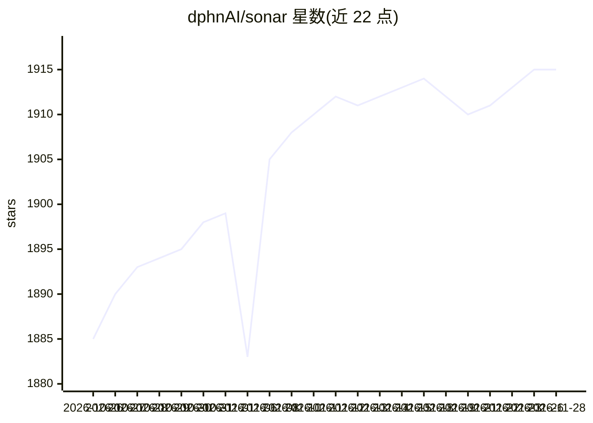

# dphnAI/sonar

⭐ 1,915 · Python · AGPL-3.0 · 推送 2026-11-22 · [GitHub](https://github.com/dphnAI/sonar) · [官网](https://sonar.dphn.ai) · 组织维护

**面向开发者的大规模 LLM 推理引擎**

基于 vLLM 的推理引擎，服务 Hugging Face 兼容的语言与多模态模型，提供连续批处理、分页 KV-cache、优化内核、量化、投机解码、LoRA 适配器服务与分布式部署。默认监听本地端口，提供 OpenAI 兼容 API 及 Anthropic、transcription 等多种 API、Prometheus 指标与健康检查。安装器覆盖 Linux x86-64/Arm64 与 Apple silicon，支持 CUDA、ROCm、CPU、Metal 等后端，另有 Docker、WSL 2、源码构建与 nightly wheels 安装途径。

## 筛选速览

| 维度 | 判定 | 备注 |
|---|---|---|
| AI 角色 | `ai-ecosystem` | LLM/agent 周边工具 |
| 许可风险 | `viral` | AGPL-3.0 |
| 部署形态 | `library` | 以包/库形式分发 |
| 模型依赖 | — | README 未给出锁定关系 |
| 硬件要求 | — | 无带数字的原话,不猜 |
| 安装摩擦 | `medium` | 含编译或系统依赖之一 |
| 成熟度 | — | 结构信号不足 |

## 能力要点

- 连续批处理与分页 KV-cache 管理，默认开启前缀缓存
- 投机解码支持 MTP、EAGLE、n-gram 等多种方法
- OpenAI 兼容 API 及流式、工具调用、结构化输出
- 张量/流水线/数据/专家并行与多节点多进程

## 适用场景

- 在本地或集群部署大模型推理服务
- 为应用提供 OpenAI 兼容的模型 API 端点
- 以 LoRA 适配器方式服务定制模型
- 生产环境监控服务指标与健康状态

## 场景标签

`推理引擎` · 领域:训练与推理

## 证据(README 行号)

> L5: Sonar is an inference engine for Hugging Face-compatible language and
> L10: Sonar is based on vLLM. It includes
> L53: The server listens on `http://127.0.0.1:2242` by default. It provides

## 星数曲线

2026-10-26 1,885 → 2026-11-28 1,915（+30）

---
*卡片 v1 · prompt 1.4 · 生成 2026-11-23 · 置信度 high · 依据 README sha `5b1661e04024` · [字段定义](../../DATASET.md)*
