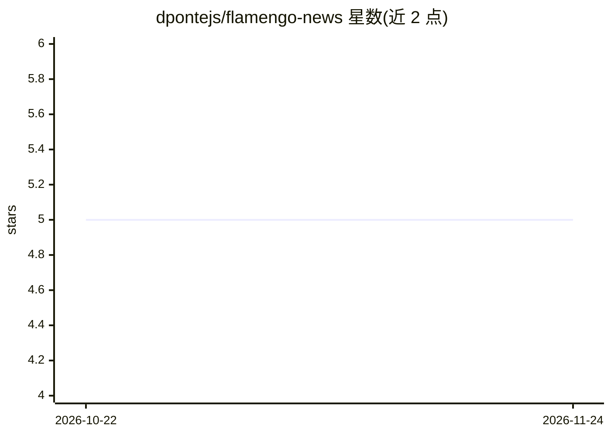

# dpontejs/flamengo-news

⭐ 5 · Python · MIT · 推送 2026-11-16 · [GitHub](https://github.com/dpontejs/flamengo-news) · 个人维护

**为球迷自动汇总新闻并由 AI 分析比赛的邮件通讯流水线**

面向 Flamengo 球迷的自动化新闻通讯流水线：按 ESPN 赛程在赛前/赛后定时运行，从 Google News、ge、官方网站等来源采集新闻，经 Gemini 按主题分组、撰写摘要与比赛分析，再通过 Resend 发送邮件；提供 FastAPI 订阅页（确认/退订、RFC 8058 一键退订），订阅数据存 SQLite。由 GitHub Actions/VPS 定时器触发；配额耗尽时仍发送无 AI 文本的降级版本；发送行为受 DRY_RUN 开关控制。

## 筛选速览

| 维度 | 判定 | 备注 |
|---|---|---|
| AI 角色 | `ai-enhanced` | 去掉 AI 部分产品仍成立 |
| 许可风险 | `permissive` | MIT |
| 部署形态 | `None` |  |
| 模型依赖 | — | README 未给出锁定关系 |
| 硬件要求 | — | 无带数字的原话,不猜 |
| 安装摩擦 | `low` | 无编译、无系统依赖或容器化 |
| 成熟度 | — | 结构信号不足 |

## 能力要点

- Gemini 驱动的新闻分组、摘要与比赛分析（prompts 为 Jinja2 模板，可编辑）
- GitHub Actions 定时触发，每次运行发布执行摘要并将 HTML 存为 artifact
- FastAPI 订阅页支持确认链接与 RFC 8058 一键退订
- DRY_RUN 默认开启，配额耗尽时降级发送（标题/链接/统计，无 AI 文本）

## 适用场景

- 订阅后每场 Flamengo 比赛前后自动收到新闻与比赛分析邮件
- 本地用 collect/stats/preview 命令查看采集结果与预览 HTML
- 参考其采集-摘要-发送流水线搭建其他主题的自动邮件通讯

## 场景标签

`网页抓取` `工作流自动化` `AI 写作` · 领域:效率与自动化

## 证据(README 行号)

> L3: Newsletter automática sobre o Flamengo (feita por um torcedor, sem ligação oficial com o clube), enviada por e-mail 
> L72: 3. Se a cota acabar, a newsletter ainda sai, com títulos, links e estatísticas, mas sem os textos

## 星数曲线

2026-10-22 5 → 2026-11-24 5（+0）

---
*卡片 v1 · prompt 1.4 · 生成 2026-11-21 · 置信度 high · 依据 README sha `da845c5b797e` · [字段定义](../../DATASET.md)*
