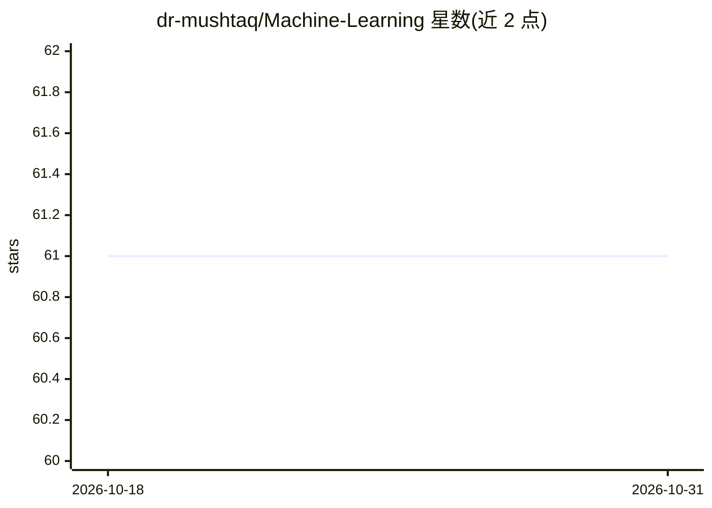

# dr-mushtaq/Machine-Learning

⭐ 61 · Jupyter Notebook · MIT · 推送 2026-10-30 · [GitHub](https://github.com/dr-mushtaq/Machine-Learning) · [官网](https://coursesteach.com/) · 个人维护

**机器学习与数据科学 A-Z 教程清单：Python 算法实现与课程资源**

面向初学者与从业者的机器学习/数据科学学习资源仓库：以 Jupyter Notebook 提供 Python 算法实现，内容按章节组织，覆盖线性代数、概率统计、优化、微积分、线性/逻辑回归、正则化、神经网络等主题，每章以表格列出教程名、视频、Colab 代码与补充资源。使用 scikit-learn 实现分类、回归、聚类、特征工程与模型评估，附课程、书籍与社区链接（YouTube、Dev.to、WhatsApp）。贡献通过 Skype 联系维护者协调。

## 筛选速览

| 维度 | 判定 | 备注 |
|---|---|---|
| AI 角色 | `ai-knowledge` | 知识聚合/清单类 |
| 许可风险 | `permissive` | MIT |
| 部署形态 | `None` |  |
| 模型依赖 | — | README 未给出锁定关系 |
| 硬件要求 | — | 无带数字的原话,不猜 |
| 安装摩擦 | `low` | 无编译、无系统依赖或容器化 |
| 成熟度 | — | 结构信号不足 |

## 能力要点

- 按章节组织的 ML 教程表：教程名+视频+Colab 代码+补充资源
- 覆盖数据预处理、监督/无监督学习、模型评估、特征工程
- 基于 scikit-learn 与 Jupyter Notebook 的实现示例
- 附课程、书籍、GitHub 资源与社区渠道

## 适用场景

- 系统自学机器学习：从数学基础到神经网络
- 按章节查找特定算法的 Colab 实现代码
- 为课程或自学收集免费 ML 教学资源

## 场景标签

`教程课程` · 领域:学习与行业

## 证据(README 行号)

> L1: ## Complete Machine Learning & Data Science A-Z Guide | Algorithms, Feature Selection & Implementation in Python
> L3: Complete A-Z Machine Learning & Data Science guide with algorithm implementations, statistical methods, and feature 
> L52: **2- Code Examples and Jupyter Notebooks**: Access code examples and Jupyter notebooks that provide step-by-step gu

## 星数曲线

2026-10-18 61 → 2026-10-31 61（+0）

---
*卡片 v1 · prompt 1.4 · 生成 2026-10-24 · 置信度 high · 依据 README sha `8b1855ce4142` · [字段定义](../../DATASET.md)*
