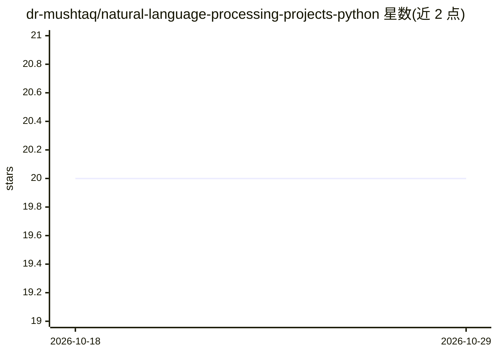

# dr-mushtaq/natural-language-processing-projects-python

⭐ 20 · Jupyter Notebook · MIT · 推送 2026-10-28 · [GitHub](https://github.com/dr-mushtaq/natural-language-processing-projects-python) · [官网](https://coursesteach.com) · 个人维护

**Python NLP 从入门到进阶的课程与实操清单**

开源 NLP 学习仓库：以课程结构（分类与向量空间、概率模型、序列模型）按周组织教学内容，条目覆盖情感分析、朴素贝叶斯、向量空间模型、隐马尔可夫与 Viterbi、n-gram 语言模型、CBOW 词嵌入、RNN/LSTM/GRU 等主题，每个条目关联视频讲解与 Colab 代码实现，含作业与小型项目（如推文情感分析、Gradio 影评分类器）。面向学生、研究者与 AI 学习者，通过 Fork、贡献与赞助参与。

## 筛选速览

| 维度 | 判定 | 备注 |
|---|---|---|
| AI 角色 | `ai-knowledge` | 知识聚合/清单类 |
| 许可风险 | `permissive` | MIT |
| 部署形态 | `None` |  |
| 模型依赖 | — | README 未给出锁定关系 |
| 硬件要求 | — | 无带数字的原话,不猜 |
| 安装摩擦 | `low` | 无编译、无系统依赖或容器化 |
| 成熟度 | — | 结构信号不足 |

## 能力要点

- 按课程分周组织的结构化 NLP 学习路线（基础→进阶→专家）
- 每个主题附视频与 Colab 代码/作业/小项目链接
- 覆盖从文本预处理、经典模型到 RNN/LSTM/Transformer 的内容

## 适用场景

- 系统学习 NLP 从基础到序列模型的课程内容
- 在 Colab 中跟做情感分析、词嵌入等实操作业
- 查找 NLP 各主题的视频教程与代码 notebook

## 场景标签

`教程课程` · 领域:学习与行业

## 证据(README 行号)

> L3: Welcome to the Natural Language Processing (NLP) Course, an open-source initiative to learn, implement, and master N
> L57: ## **🧭 Suggested Learning Path (Basic → Advanced → Expert)**
> L222: This course dives deep into sequence modeling techniques for Natural Language Processing (NLP), covering foundatio

## 星数曲线

2026-10-18 20 → 2026-10-29 20（+0）

---
*卡片 v1 · prompt 1.4 · 生成 2026-10-28 · 置信度 high · 依据 README sha `c291ab90eb75` · [字段定义](../../DATASET.md)*
