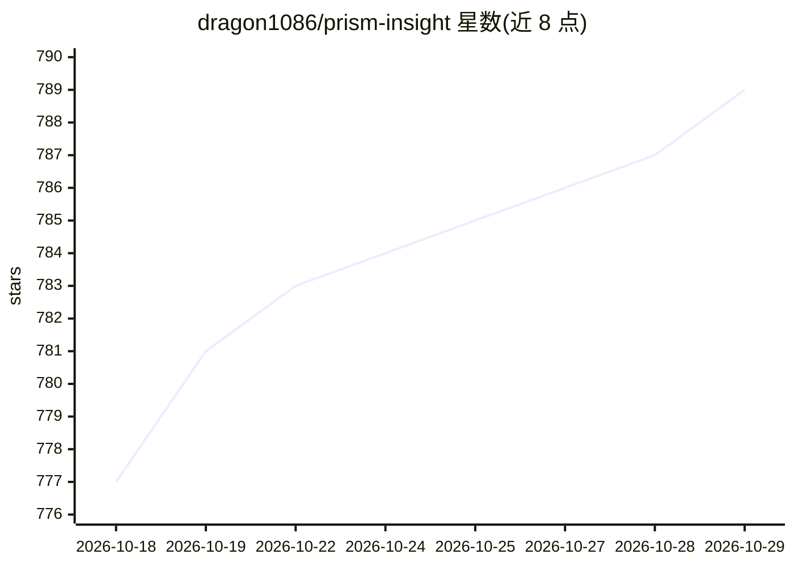

# dragon1086/prism-insight

⭐ 789 · Python · AGPL-3.0 · 推送 2026-10-28 · [GitHub](https://github.com/dragon1086/prism-insight) · [官网](https://prism-insight-landing.vercel.app/) · 个人维护 · 中文 README

**面向个人投资者的多 Agent 股票分析与自动交易系统**

开源的 AI 股票分析与交易系统，覆盖韩国（KOSPI/KOSDAQ）与美国（NYSE/NASDAQ）市场。由按执行路径分组的多个 AI agent 协作：规则式市场状态检测之上的宏观分析、每市场 6 个基础报告分部、运行时生成的策略与摘要、买卖决策 agent，以及将已平仓交易结果回灌到后续决策的交易日志与记忆机制。支持异动股筛选、PDF 报告生成、Telegram 多语言推送、通过韩国投资证券 API 的实盘执行。默认使用 OpenAI 系列 GPT 模型，可选 Claude Sonnet 作为按需洞察模型；可用 OpenAI API key 或 ChatGPT Plus/Pro 订阅（Codex OAuth Proxy）运行。提供 Python 与 Docker 两种安装方式及移动应用。README 同时公开模拟交易业绩的两种口径及落后于指数的情况。

## 筛选速览

| 维度 | 判定 | 备注 |
|---|---|---|
| AI 角色 | `ai-native` | 本体是模型或模型工具 |
| 许可风险 | `dual` | AGPL-3.0 |
| 部署形态 | `self-host` | docker 或自建部署 |
| 模型依赖 | — | README 未给出锁定关系 |
| 硬件要求 | — | 无带数字的原话,不猜 |
| 安装摩擦 | `low` | 无编译、无系统依赖或容器化 |
| 成熟度 | — | 结构信号不足 |

## 能力要点

- 按执行路径分组的多 agent 体系（宏观/分析/策略/交易/日志记忆/沟通）
- 交易日志反馈回路：已平仓结果自动影响后续买入决策
- 可通过 ChatGPT Plus/Pro 订阅经 Codex OAuth Proxy 运行，无需 API key
- 支持韩国投资证券 API 实盘执行与 Telegram 多语言推送

## 适用场景

- 自动筛选异动股并生成分析师级 PDF 报告
- 运行 AI 驱动的买卖模拟决策与组合管理
- 经 Telegram 接收多语言的实时提醒与 AI 分析报告

## 场景标签

`金融量化` · 领域:学习与行业

## 证据(README 行号)

> L25: > 13+ specialized AI agents collaborate to detect surge stocks, generate analyst-grade reports, and execute trades 
> L197: - **AI Analysis Reports** — Professional analyst-grade reports generated by specialized AI agents
> L199: - **Automated Trading** — Real execution via Korea Investment & Securities API

## 星数曲线

2026-10-18 777 → 2026-10-29 789（+12）

---
*卡片 v1 · prompt 1.4 · 生成 2026-10-21 · 置信度 mid · 依据 README sha `c4758a941700` · [字段定义](../../DATASET.md)*
