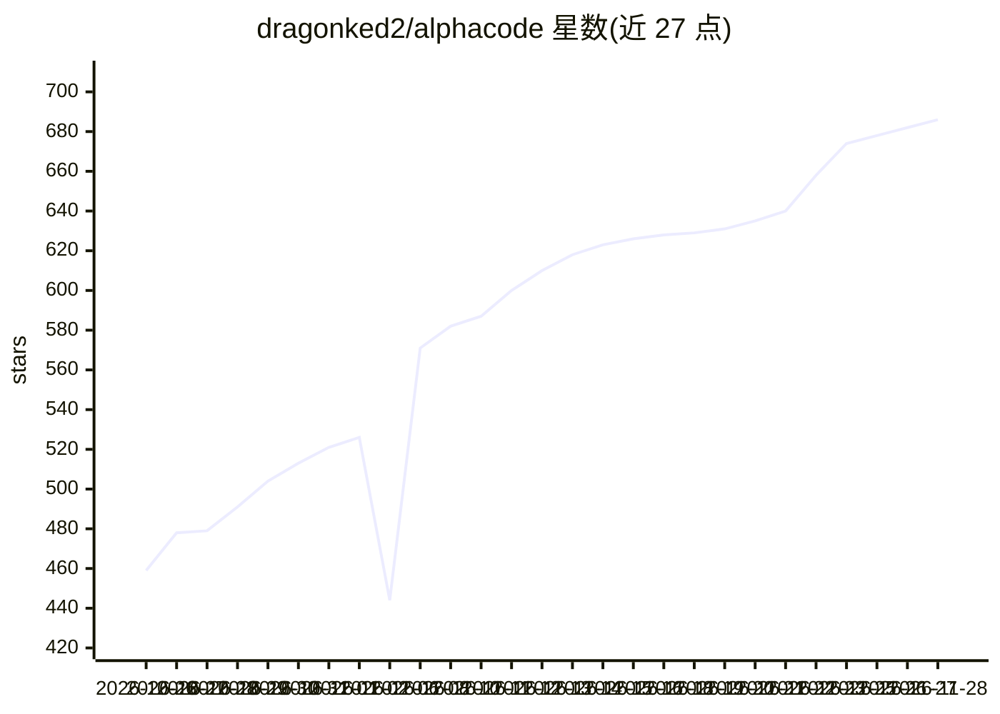

# dragonked2/alphacode

⭐ 686 · Rust · MIT · 推送 2026-11-27 · [GitHub](https://github.com/dragonked2/alphacode) · [官网](https://alphacli.github.io/) · 个人维护

**终端里的免费开源 AI 编码 agent，可编辑文件并执行任务**

用 Rust 编写的终端 AI 编码 agent：读取仓库、规划任务、编辑文件、运行命令与测试，并可通过扩展驱动真实 Firefox 会话和原生桌面应用。工作循环为理解-规划-执行-观察-验证-报告，会话保存到磁盘可恢复。内置免费模型无需 API key 即可启动，也可接入 Claude、GPT、Gemini、Ollama 等 OpenAI 兼容端点。提供 Swarm 多 agent 并行模式、40+ 内置工具、权限确认与安全检查。提供 macOS/Linux 一键安装脚本与 Windows PowerShell 安装脚本。

## 筛选速览

| 维度 | 判定 | 备注 |
|---|---|---|
| AI 角色 | `ai-native` | 本体是模型或模型工具 |
| 许可风险 | `permissive` | MIT |
| 部署形态 | `desktop` | 安装包/桌面程序 |
| 模型依赖 | local-ok | 支持本地模型 |
| 硬件要求 | — | 无带数字的原话,不猜 |
| 安装摩擦 | `medium` | 含编译或系统依赖之一 |
| 成熟度 | — | 结构信号不足 |

## 能力要点

- 内置免费模型，无需 API key 与注册即可启动
- 40+ 内置 agent 工具：文件、shell、web、UI 操作
- Swarm 模式将大目标拆分到并行 agent
- 会话可恢复（支持重启、崩溃、SSH 断连后继续）

## 适用场景

- 在终端里让 agent 修复 bug、补测试并跑通测试套件
- 让 agent 解释陌生代码库的结构与入口
- 通过 Firefox 扩展自动化测试 Web 应用的表单
- 用 /swarm 从架构、安全、测试等角度并行分析项目

## 场景标签

`编码 Agent` `多智能体` `浏览器自动化` · 领域:Agent 开发

## 证据(README 行号)

> L111: **AlphaCode is a free, open-source AI coding agent written in Rust that runs in your terminal.** Instead of only s
> L115: It is an open-source alternative to terminal coding agents such as Claude Code, Codex CLI, Aider, and OpenCode, wi
> L9: **No API key needed to start.** Or bring Claude, GPT, Gemini, DeepSeek, GitHub Copilot, OpenRouter, Ollama, LM Studi

## 星数曲线

2026-10-26 459 → 2026-11-28 686（+227）

---
*卡片 v1 · prompt 1.4 · 生成 2026-11-28 · 置信度 high · 依据 README sha `29345270cf5e` · [字段定义](../../DATASET.md)*
