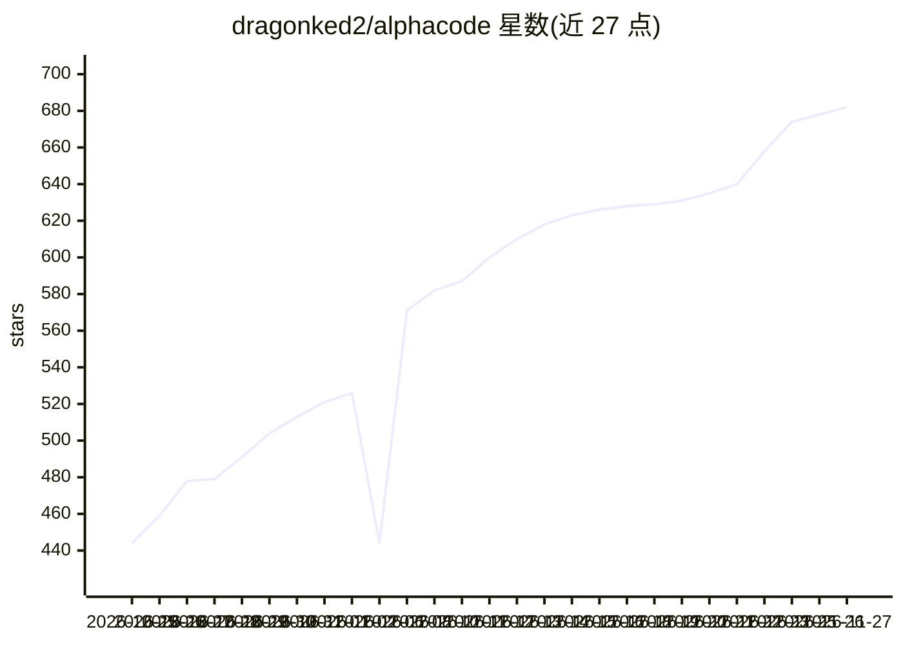

# dragonked2/alphacode

⭐ 682 · Rust · MIT · 推送 2026-11-26 · [GitHub](https://github.com/dragonked2/alphacode) · [官网](https://alphacli.github.io/) · 个人维护

**终端里的免费开源 AI 编码 agent，无需 API key 即可启动**

Rust 编写的终端 AI 编码 agent，遵循理解—规划—执行—观察—验证的循环：读取仓库、编辑文件、运行命令与测试、驱动真实 Firefox 会话、控制桌面应用并汇报验证结果。内置免费模型无需 API key 和注册即可使用，也可接入 Claude、GPT、Gemini、DeepSeek、Ollama 等 OpenAI 兼容端点。提供 40+ 内置工具、Swarm 多 agent 并行模式、会话持久化（可从重启/崩溃/SSH 断连恢复）、MCP 服务器与技能扩展，MIT 许可。

## 筛选速览

| 维度 | 判定 | 备注 |
|---|---|---|
| AI 角色 | `ai-native` | 本体是模型或模型工具 |
| 许可风险 | `permissive` | MIT |
| 部署形态 | `desktop` | 安装包/桌面程序 |
| 模型依赖 | — | README 未给出锁定关系 |
| 硬件要求 | — | 无带数字的原话,不猜 |
| 安装摩擦 | `medium` | 含编译或系统依赖之一 |
| 成熟度 | — | 结构信号不足 |

## 能力要点

- 内置免费模型，无需 API key 与注册即可开始
- 40+ agent 工具覆盖文件、shell、web、Firefox 浏览器与桌面自动化
- Swarm 模式将大目标拆分给并行 agent
- Rust 原生二进制，README 称单会话约 28 MB 内存，会话可恢复

## 适用场景

- 在终端中让 agent 修复 bug、添加功能并运行测试验证
- 通过 Firefox 自动化测试 Web 应用的表单交互
- 用 Swarm 模式从架构/安全/测试/性能多角度并行分析项目
- 在脚本与 CI 中通过 JSON 输出模式运行编码任务

## 场景标签

`编码 Agent` `多智能体` `GUI 自动化` `浏览器自动化` · 领域:Agent 开发

## 证据(README 行号)

> L7: **Built in Rust. Understands your codebase, edits files, runs commands and tests, drives a real Firefox session, con
> L110: **AlphaCode is a free, open-source AI coding agent written in Rust that runs in your terminal.** Instead of only s

## 星数曲线

2026-10-25 444 → 2026-11-27 682（+238）

---
*卡片 v1 · prompt 1.4 · 生成 2026-11-26 · 置信度 high · 依据 README sha `aa4a403d81e4` · [字段定义](../../DATASET.md)*
