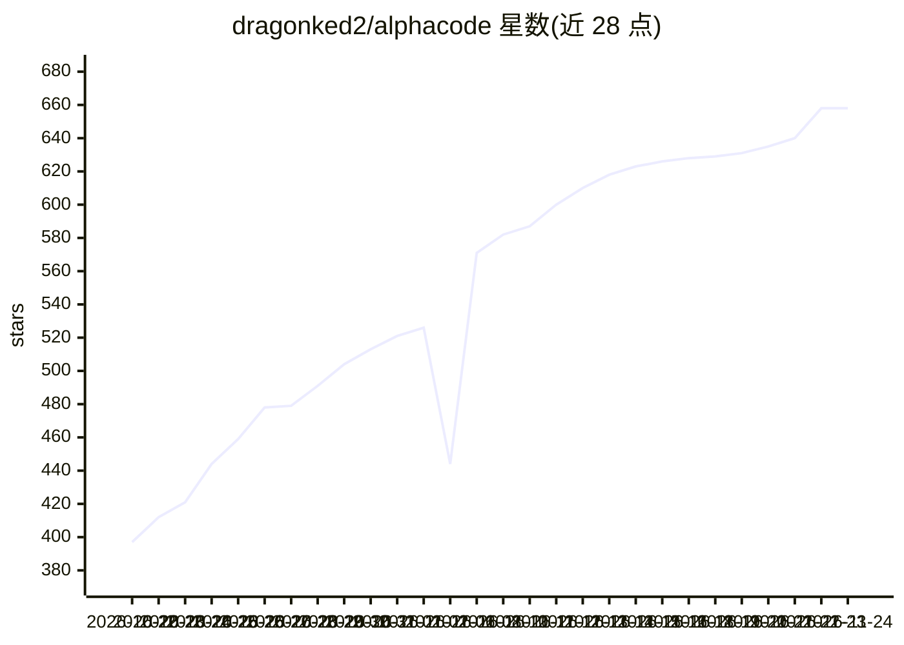

# dragonked2/alphacode

⭐ 658 · Rust · MIT · 推送 2026-11-22 · [GitHub](https://github.com/dragonked2/alphacode) · [官网](https://alphacli.github.io/) · 个人维护

**开发者终端里的 Rust AI 编码 Agent，无需 API key 即可启动**

用 Rust 编写的终端 AI 编码代理：理解代码库、编辑文件、运行命令与测试、驱动真实 Firefox 会话、控制桌面应用，并以「理解-计划-执行-观察-验证」循环产出变更报告。内置免费模型无需 API key 即可开始，也可接入 Claude、GPT、Gemini、DeepSeek、Ollama 等 50 余个 OpenAI 兼容端点。提供 40+ 工具、Swarm 多代理并行模式、会话可恢复机制；通过权限提示与 diff 审查控制风险。以单二进制分发，提供安装脚本与 doctor 环境检查。

## 筛选速览

| 维度 | 判定 | 备注 |
|---|---|---|
| AI 角色 | `ai-native` | 本体是模型或模型工具 |
| 许可风险 | `permissive` | MIT |
| 部署形态 | `desktop` | 安装包/桌面程序 |
| 模型依赖 | local-ok | 支持本地模型 |
| 硬件要求 | — | 无带数字的原话,不猜 |
| 安装摩擦 | `medium` | 含编译或系统依赖之一 |
| 成熟度 | — | 结构信号不足 |

## 能力要点

- 内置免费 AI，无需 API key 与注册即可开始
- 40+ agent 工具，覆盖文件、shell、网页、Firefox 与桌面 UI 自动化
- Swarm 模式将大目标拆分给并行 agent
- 会话持久化，可在重启、崩溃、SSH 断连后恢复

## 适用场景

- 让 Agent 自动修复失败测试并重跑验证
- 对新代码库做结构讲解与入口分析
- 通过 Firefox 自动化测试 Web 应用的表单
- Swarm 并行做架构、安全、测试多视角审查

## 场景标签

`编码 Agent` `多智能体` · 领域:Agent 开发

## 证据(README 行号)

> L7: **Built in Rust. Understands your codebase, edits files, runs commands and tests, drives a real Firefox session, con
> L110: **AlphaCode is a free, open-source AI coding agent written in Rust that runs in your terminal.** Instead of only s
> L114: It is an open-source alternative to terminal coding agents such as Claude Code, Codex CLI, Aider, and OpenCode, wi

## 星数曲线

2026-10-22 397 → 2026-11-24 658（+261）

---
*卡片 v1 · prompt 1.4 · 生成 2026-11-24 · 置信度 high · 依据 README sha `1c272a5c2367` · [字段定义](../../DATASET.md)*
