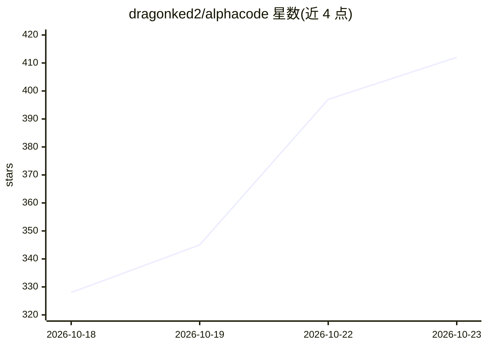

# dragonked2/alphacode

⭐ 412 · Rust · MIT · 推送 2026-10-22 · [GitHub](https://github.com/dragonked2/alphacode) · [官网](https://alphacli.github.io/) · 个人维护

**Rust 编写的终端 AI 编码 agent，含浏览器与桌面自动化**

开源 MIT 许可、用 Rust 实现的终端 AI 编码代理：理解代码库、规划任务、编辑文件、执行命令与测试、搜索网页、通过原生消息驱动真实 Firefox 会话、经平台无障碍 API 操作桌面应用，并运行测试核验自身工作。模型无关：内置免 API key 的免费 AI 通道，可接入 Claude、GPT、Gemini、Copilot、Bedrock、Azure、OpenRouter 及 Ollama/LM Studio 等本地模型。提供 Swarm 多 agent 并行模式、持久会话、项目记忆与 MCP/Skills 扩展。跨 Windows/macOS/Linux 提供安装脚本。

## 筛选速览

| 维度 | 判定 | 备注 |
|---|---|---|
| AI 角色 | `ai-native` | 本体是模型或模型工具 |
| 许可风险 | `permissive` | MIT |
| 部署形态 | `desktop` | 安装包/桌面程序 |
| 模型依赖 | local-ok | 支持本地模型 |
| 硬件要求 | — | 无带数字的原话,不猜 |
| 安装摩擦 | `medium` | 含编译或系统依赖之一 |
| 成熟度 | — | 结构信号不足 |

## 能力要点

- 内置免费 AI 通道，无需 API key 即可开始
- Firefox 浏览器自动化（扩展 + 原生消息桥）与桌面无障碍 API 自动化
- Swarm 模式并行协调多个 agent；持久会话跨终端重启恢复
- 支持 Claude/GPT/Gemini/Bedrock/Azure/OpenRouter 及 OpenAI 兼容端点（含 Ollama、LM Studio）

## 适用场景

- 在终端用自然语言让 agent 探索代码库、修 bug、跑测试
- 驱动真实 Firefox 会话做网页 QA、表单验证与截图
- 并行多 agent 分析项目的架构、安全与性能
- 用本地 Ollama/LM Studio 模型做编码代理后端

## 场景标签

`编码 Agent` `浏览器自动化` `GUI 自动化` `多智能体` · 领域:Agent 开发

## 证据(README 行号)

> L60: **AlphaCode is an open-source AI coding agent written in Rust that runs in your terminal.** Instead of only suggest
> L189: |**AI coding agent**|Understands natural-language tasks, plans multi-step work, edits code, and checks results|

## 星数曲线

2026-10-18 328 → 2026-10-23 412（+84）

---
*卡片 v1 · prompt 1.4 · 生成 2026-10-21 · 置信度 high · 依据 README sha `618da5ac97dc` · [字段定义](../../DATASET.md)*
