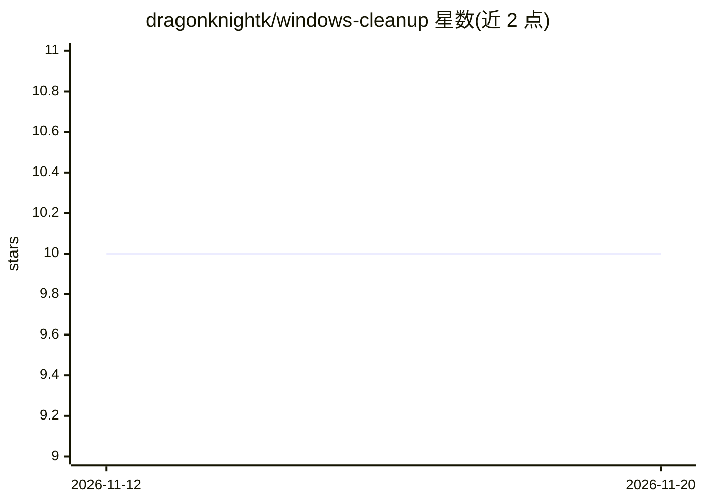

# dragonknightk/windows-cleanup

⭐ 10 · PowerShell · MIT · 推送 2026-11-07 · [GitHub](https://github.com/dragonknightk/windows-cleanup) · 个人维护 · 中文 README

**给 AI Agent 用的 Windows 软件审查、卸载与残留清理 Skill**

以 SKILL.md 形式安装到支持 Skill 机制的 AI 编程助手技能目录的 Windows 清理技能：通过只读 PowerShell 脚本跨注册表、进程、服务、计划任务、启动项、环境变量与文件签名收集证据，按固定五维版式输出审查结论，经用户授权后执行正式卸载与回收站移入。内置 12 项路径红线拦截、6 类系统基础项排除、批量审查每批 10 项的分批硬停点，以及凭据自动脱敏。要求 Windows 10/11 与 PowerShell 7.2+，无外部依赖。

## 筛选速览

| 维度 | 判定 | 备注 |
|---|---|---|
| AI 角色 | `ai-enhanced` | 去掉 AI 部分产品仍成立 |
| 许可风险 | `permissive` | MIT |
| 部署形态 | `None` |  |
| 模型依赖 | — | README 未给出锁定关系 |
| 硬件要求 | — | 无带数字的原话,不猜 |
| 安装摩擦 | `medium` | 含编译或系统依赖之一 |
| 成熟度 | — | 结构信号不足 |

## 能力要点

- 跨注册表、进程、服务、计划任务 XML 与文件签名的多源只读取证
- 固定五维审查报告（来源/用途/可否删除/影响/恢复）与每批 10 项硬停点
- C# P/Invoke 调用 Win32 IFileOperation 移入回收站并双重回调校验
- 12 项路径红线拦截与 Bearer/Token/密码自动脱敏

## 适用场景

- 查明 AppData、ProgramData 里的陌生目录哪些能安全清理
- 分批盘点用户目录下的非系统文件夹
- 正式卸载旧软件并排查其服务、计划任务与残留
- 检查 PATH 环境变量与启动项中失效的旧软件路径

## 场景标签

 · 领域:系统工具/Windows 运维

## 证据(README 行号)

> L15: `windows-cleanup` 是一个专为支持 Skill 机制的 AI 编程助手（如 Codex CLI、Claude Code、Antigravity、Cursor 等）设计的 **Windows 系统与软件深度审查、卸载
> L17: 与传统“一键清理”工具仅凭文件名或目录名盲目删除不同，本仓库**不包含任何黑盒自动删除程序**。它通过结构化的调查规程与只读辅助脚本，引导 AI Agent 先在本地收集多维证据（注册表卸载项、进程、服务、计划任务、启动项、环境变
> L71: - **宿主工具**：支持 `SKILL.md` 规范的 AI Agent

## 星数曲线

2026-11-12 10 → 2026-11-20 10（+0）

---
*卡片 v1 · prompt 1.4 · 生成 2026-11-19 · 置信度 high · 依据 README sha `73be5c4af192` · [字段定义](../../DATASET.md)*
