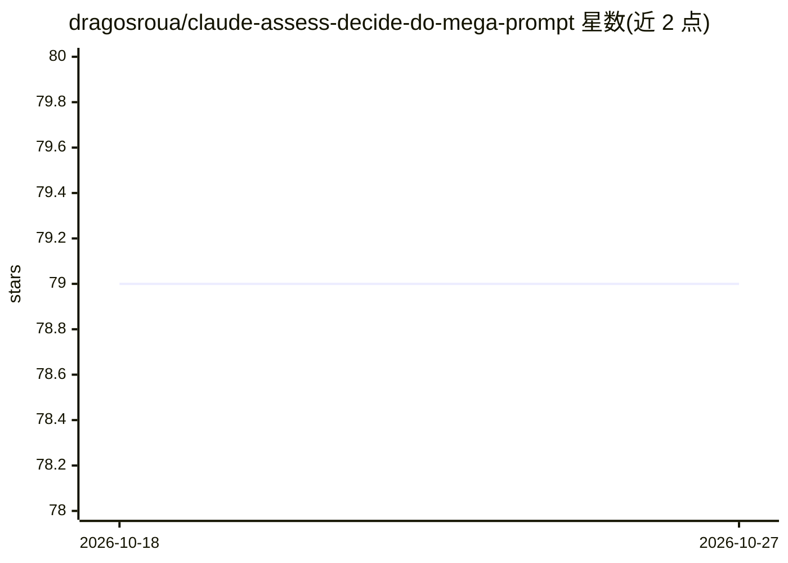

# dragosroua/claude-assess-decide-do-mega-prompt

⭐ 79 · Shell · MIT · 推送 2026-02-03 · [GitHub](https://github.com/dragosroua/claude-assess-decide-do-mega-prompt) · [官网](https://dragosroua.com/supercharging-claude-with-the-assess-decide-do-framework-mega-prompt-inside/) · 个人维护

**让 Claude 识别用户认知阶段（评估/决策/执行）的提示词框架**

基于作者 2010 年提出的 Assess-Decide-Do 生产力框架，以 megaprompt 与 Claude Code skills 的形式让 Claude 根据语言模式检测用户当前所处的认知阶段（Assess/Decide/Do），并按阶段调整回应策略（探索期不催促决策、执行期保持专注），同时检测分析瘫痪等失衡状态。提供三种接入方式：自定义指令、对话内加载文件、克隆仓库启用 skills（含 /add-status、/add-reflect 命令与可视化状态栏）。框架已在 Gemini、Grok、Kimi 上测试兼容，Claude 为主要实现。

## 筛选速览

| 维度 | 判定 | 备注 |
|---|---|---|
| AI 角色 | `ai-ecosystem` | LLM/agent 周边工具 |
| 许可风险 | `permissive` | MIT |
| 部署形态 | `None` |  |
| 模型依赖 | locked-api |  |
| 硬件要求 | — | 无带数字的原话,不猜 |
| 安装摩擦 | `low` | 无编译、无系统依赖或容器化 |
| 成熟度 | — | 结构信号不足 |

## 能力要点

- 三种接入方式：Custom Instructions、对话加载 megaprompt、Claude Code skills 自动加载
- /add-status 与 /add-reflect 命令，附可视化领域状态栏
- 检测分析瘫痪、决策回避、执行捷径等失衡模式
- 多模型兼容：Claude 为主，Gemini/Grok/Kimi 已测试

## 适用场景

- 让 Claude 在我探索想法时不急于给方案
- 开发项目中通过 Claude Code skills 获得阶段感知支持
- 需要认知负荷管理的 ADHD 用户管理工作流节奏

## 场景标签

`提示工程` `AI 助手` · 领域:Agent 开发

## 证据(README 行号)

> L37: The **Assess-Decide-Do (ADD) framework** teaches Claude to recognize three fundamental cognitive states:
> L139: **Level 1: Claude Operating with ADD Awareness**
> L232: The ADD framework has been successfully tested with multiple LLMs:

## 星数曲线

2026-10-18 79 → 2026-10-27 79（+0）

---
*卡片 v1 · prompt 1.4 · 生成 2026-10-24 · 置信度 high · 依据 README sha `c13537f1ee7f` · [字段定义](../../DATASET.md)*
