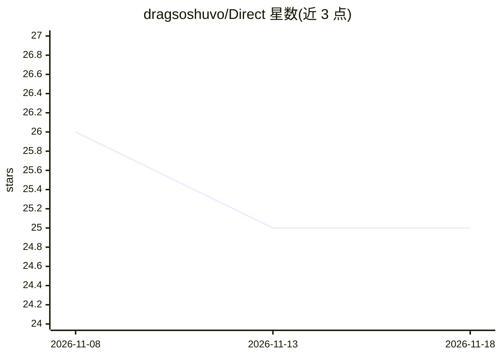

# dragsoshuvo/Direct

⭐ — · [GitHub]() · 组织维护

**加速 MRI 重建的深度学习框架：覆盖数据加载到部署**

DIRECT 是用于加速 MRI 重建的深度学习框架，覆盖实用工作流：数据集加载、模型配置、训练、评估与部署。以 Python 包形式提供，通过 pip 安装后使用 `direct` CLI 作为训练与评估入口；实验配置存放于 `projects/` 目录，包含已发表论文的复现配置，`docs/` 提供指南、教程与 API 说明。本仓库是原 DIRECT MRI 重建项目的维护分支，保留原始训练管线与配置接口。

## 筛选速览

| 维度 | 判定 | 备注 |
|---|---|---|
| AI 角色 | `ai-native` | 本体是模型或模型工具 |
| 许可风险 | `permissive` | — |
| 部署形态 | `library` | 以包/库形式分发 |
| 模型依赖 | — | README 未给出锁定关系 |
| 硬件要求 | — | 无带数字的原话,不猜 |
| 安装摩擦 | `low` | 无编译、无系统依赖或容器化 |
| 成熟度 | — | 结构信号不足 |

## 能力要点

- 覆盖数据加载、模型配置、训练、评估到部署的工作流
- `direct` CLI 作为训练与评估入口
- `projects/` 内含已发表实验的复现配置

## 适用场景

- 训练与评估加速 MRI 重建模型
- 复现已发表论文的实验配置
- 构建从数据加载到部署的 MRI 重建流程

## 场景标签

`模型训练` · 领域:训练与推理

## 证据(README 行号)

> L3: **Deep learning framework for accelerated MRI reconstruction.**
> L5: DIRECT covers the practical workflow around learned MRI reconstruction: dataset loading, model

## 星数曲线

2026-11-08 26 → 2026-11-18 25（-1）

---
*卡片 v1 · prompt 1.4 · 生成 2026-11-18 · 置信度 high · 依据 README sha `0a8fd0dd830e` · [字段定义](../../DATASET.md)*
