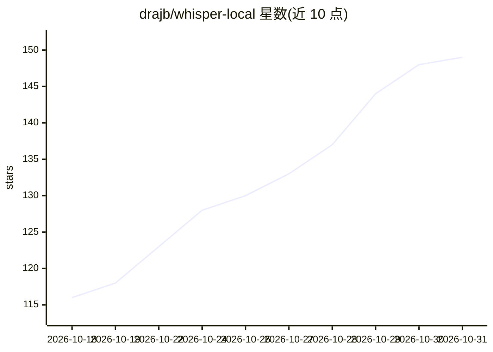

# drajb/whisper-local

⭐ 149 · Python · MIT · 推送 2026-10-20 · [GitHub](https://github.com/drajb/whisper-local) · [官网](https://gekro.com) · 个人维护

**离线 AI 听写工具：按键说话，文字出现在光标处**

面向 Windows/macOS 用户的本地语音听写应用：基于 faster-whisper（CTranslate2）在本地运行 Whisper 模型，按住全局热键说话，转写文本自动粘贴到任意应用的光标处。提供推送说话、内联标点口令、按应用分风格、词汇纠错、本地 Ollama 文本改写、翻译模式与 OpenAI 兼容本地转写 API（--serve）。默认无网络调用，GPU 加速可选 NVIDIA CUDA / AMD ROCm，CPU 即可用。Windows 提供独立 exe，也可 pipx 安装（Python 3.11+），MIT 许可，个人维护者发布。

## 筛选速览

| 维度 | 判定 | 备注 |
|---|---|---|
| AI 角色 | `ai-native` | 本体是模型或模型工具 |
| 许可风险 | `permissive` | MIT |
| 部署形态 | `desktop` | 安装包/桌面程序 |
| 模型依赖 | local-ok | 支持本地模型 |
| 硬件要求 | — | 无带数字的原话,不猜 |
| 安装摩擦 | `medium` | 含编译或系统依赖之一 |
| 成熟度 | — | 结构信号不足 |

## 能力要点

- faster-whisper 本地转写，全程离线，无遥测
- 全局热键 + 自动粘贴到任意应用光标处
- 本地 Ollama 驱动的 AI 改写/清理（默认关闭）
- --serve 暴露 OpenAI 兼容的 /v1/audio/transcriptions 本地 API

## 适用场景

- 在任意应用里用语音打字，音频不出本机
- 不想订阅 Wispr Flow/Dragon 的免费离线替代
- 把本地转写 API 供给 Cursor 等工具调用

## 场景标签

`语音识别` · 领域:感知与多模态

## 证据(README 行号)

> L32: Whisper Local is a **free, open-source, fully offline alternative to Wispr Flow, Dragon, and Otter** for power user
> L6: No cloud. No subscription. No telemetry. Powered by OpenAI Whisper.

## 星数曲线

2026-10-18 116 → 2026-10-31 149（+33）

---
*卡片 v1 · prompt 1.4 · 生成 2026-10-23 · 置信度 high · 依据 README sha `365bfe88f38d` · [字段定义](../../DATASET.md)*
