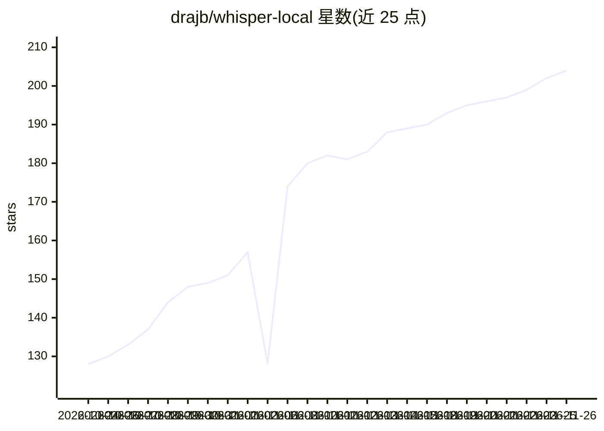

# drajb/whisper-local

⭐ 204 · Python · MIT · 推送 2026-11-17 · [GitHub](https://github.com/drajb/whisper-local) · [官网](https://gekro.com) · 个人维护

**Windows/macOS 全离线语音听写工具：按键说话即出文字**

基于 faster-whisper（CTranslate2）的桌面听写应用：全局按键说话、自动粘贴到光标处，支持语音命令、内联标点口述、写作风格、片段（snippets）、逐词纠错词典、翻译模式与按应用规则。音频全程不离开本机，无账号与订阅；首次启动下载约 141 MB 模型后离线运行。Windows 提供独立 exe（含构建溯源证明），也可 pipx/pip 安装。AI 改写与清理功能依赖本地 Ollama，默认关闭。

## 筛选速览

| 维度 | 判定 | 备注 |
|---|---|---|
| AI 角色 | `ai-native` | 本体是模型或模型工具 |
| 许可风险 | `permissive` | MIT |
| 部署形态 | `desktop` | 安装包/桌面程序 |
| 模型依赖 | local-ok | 支持本地模型 |
| 硬件要求 | — | 无带数字的原话,不猜 |
| 安装摩擦 | `medium` | 含编译或系统依赖之一 |
| 成熟度 | — | 结构信号不足 |

## 能力要点

- 全局 push-to-talk 热键，在任何应用的光标处输出转写文本
- 基于 faster-whisper 的本地转写，支持 NVIDIA CUDA 与 AMD ROCm 加速
- 本地 Ollama 实现文本改写与可选的转写清理（默认关闭）
- 本地 OpenAI 兼容 API（localhost:7777 /v1/audio/transcriptions）

## 适用场景

- 在聊天、编辑器、终端等任意应用中语音输入文字
- 离线或隔离网络环境下进行语音转写
- 会议或视频中把系统声音转成文字（实验性，Windows）

## 场景标签

`语音识别` · 领域:感知与多模态

## 证据(README 行号)

> L32: Whisper Local is a **free, open-source, fully offline alternative to Wispr Flow, Dragon, and Otter** for power user
> L92: - 🤖 **AI rephrase** — dedicated `Ctrl+Shift+Win` hotkey: select text, hold, speak your instruction, release — local

## 星数曲线

2026-10-24 128 → 2026-11-26 204（+76）

---
*卡片 v1 · prompt 1.4 · 生成 2026-11-25 · 置信度 high · 依据 README sha `2e8fb3ac09b9` · [字段定义](../../DATASET.md)*
