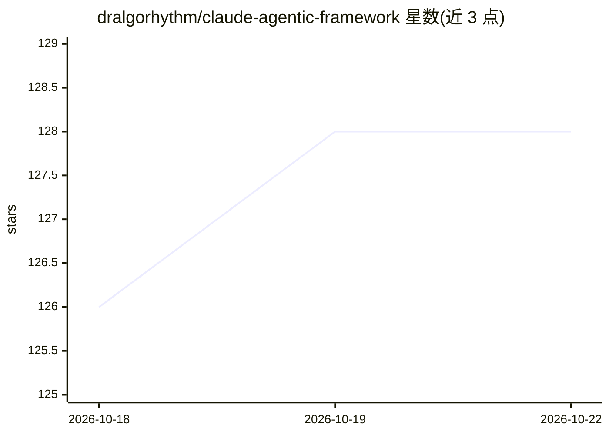

# dralgorhythm/claude-agentic-framework

⭐ 128 · Shell · 推送 2026-07-24 · [GitHub](https://github.com/dralgorhythm/claude-agentic-framework) · 个人维护

**Claude Code 项目多 Agent 协作框架模板（技能+Agent+安全钩子）**

面向 Claude Code 使用者的 drop-in 项目模板：一条初始化脚本复制技能、5 类 worker agent、群集编排命令（/swarm-plan、/swarm-execute、/swarm-review 等）、9 个库技能、安全钩子（密钥检测、受保护文件、推送阻断、危险命令守卫）及 MCP 服务器配置。也可作为 Claude Code 插件安装，但不包含 settings.json 权限规则与 rules 目录。技能目录采用开放 Agent Skills 标准，可被 40+ 客户端（含 GitHub Copilot agent）读取。仓库当前无 LICENSE 文件，明确声明不构成许可授予。

## 筛选速览

| 维度 | 判定 | 备注 |
|---|---|---|
| AI 角色 | `ai-ecosystem` | LLM/agent 周边工具 |
| 许可风险 | `none` | — |
| 部署形态 | `desktop` | 安装包/桌面程序 |
| 模型依赖 | locked-api |  |
| 硬件要求 | — | 无带数字的原话,不猜 |
| 安装摩擦 | `low` | 无编译、无系统依赖或容器化 |
| 成熟度 | — | 结构信号不足 |

## 能力要点

- 单命令初始化的零依赖 drop-in 模板（clone + init 脚本）
- 群集编排：最多 8 个并行 builder 与 5 个并行 reviewer
- 安全钩子：密钥检测、受保护文件、推送阻断、危险命令守卫
- 技能基于开放 Agent Skills 标准，兼容 40+ 客户端原地读取

## 适用场景

- 在 Claude Code 项目中引入多 agent 分工与强制评审流程
- 为团队统一配置安全钩子与权限拒绝规则
- 让 GitHub Copilot 等其他客户端复用同一套技能目录

## 场景标签

`多智能体` `编码 Agent` `Agent 框架` · 领域:Agent 开发

## 证据(README 行号)

> L3: A drop-in template for Claude Code projects. Adds coordinated multi-agent swarms, specialized workflow skills, a lea
> L62: `.claude/skills/` isn't a Claude-only format anymore. Agent Skills is an open standard now supported by 40+ Agent S

## 星数曲线

2026-10-18 126 → 2026-10-22 128（+2）

---
*卡片 v1 · prompt 1.4 · 生成 2026-10-22 · 置信度 high · 依据 README sha `116c2e1df683` · [字段定义](../../DATASET.md)*
