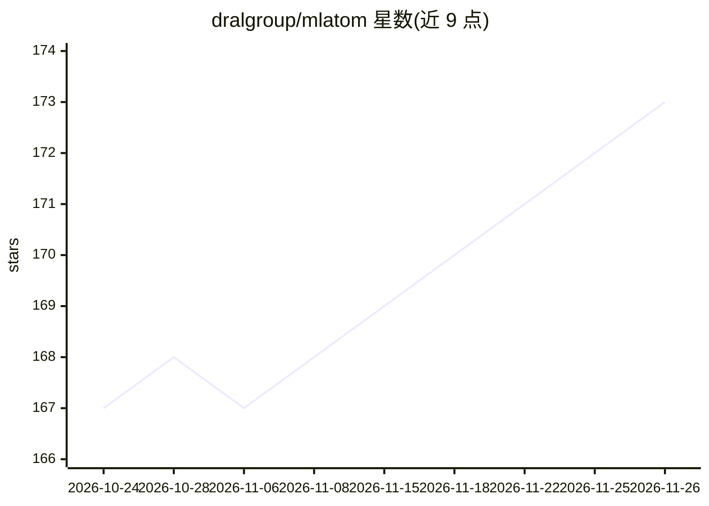

# dralgroup/mlatom

⭐ 173 · Python · Apache-2.0 · 推送 2026-11-25 · [GitHub](https://github.com/dralgroup/mlatom) · [官网](http://mlatom.com) · 组织维护

**为计算化学研究者提供机器学习与量子化学方法的原子模拟包**

开源的原子模拟包，将机器学习势与量子化学方法（DFT、波函数、半经验）结合，支持几何优化、过渡态搜索、分子动力学、光谱计算与周期性边界条件等任务。可通过 Python 库、输入文件或命令行使用。AIQM 系列方法以半经验成本提供接近耦合簇的精度。仅 Linux 经验证支持，Windows 不支持，macOS 未测试；提供 Aitomistic Hub/Lab 在线运行，无需安装。

## 筛选速览

| 维度 | 判定 | 备注 |
|---|---|---|
| AI 角色 | `ai-native` | 本体是模型或模型工具 |
| 许可风险 | `permissive` | Apache-2.0 |
| 部署形态 | `library` | 以包/库形式分发 |
| 模型依赖 | — | README 未给出锁定关系 |
| 硬件要求 | — | 无带数字的原话,不猜 |
| 安装摩擦 | `low` | 无编译、无系统依赖或容器化 |
| 成熟度 | — | 结构信号不足 |

## 能力要点

- AIQM1/AIQM2/AIQM3/UAIQM 等 AI 增强量子化学方法
- 可训练多种 ML 势（KREG、GAP-SOAP、ANI、MACE 等）并支持主动学习、Δ-learning、迁移学习
- 提供 PySCF、Gaussian、ORCA、xtb 等 QM 程序接口
- 在线平台可免安装在浏览器中运行

## 适用场景

- 用 AIQM2 等方法优化分子几何结构
- 训练机器学习势并做分子动力学模拟
- 计算频率、热化学与 IR/Raman/UV-vis 光谱

## 场景标签

`科研工具` `模型训练` · 领域:学习与行业

## 证据(README 行号)

> L11: MLatom is an open-source package for **atomistic simulations with machine learning and quantum chemical methods** —
> L62: Optimize the geometry of a water molecule with **AIQM2** — an AI-enhanced quantum-mechanical method (native to MLat
> L90: - **Methods** — universal ML potentials (ANI, AIMNet2); AI-enhanced QM methods (UAIQM, AIQM1, AIQM2, AIQM3) approac

## 星数曲线

2026-10-24 167 → 2026-11-26 173（+6）

---
*卡片 v1 · prompt 1.4 · 生成 2026-11-26 · 置信度 high · 依据 README sha `4118ab93f707` · [字段定义](../../DATASET.md)*
