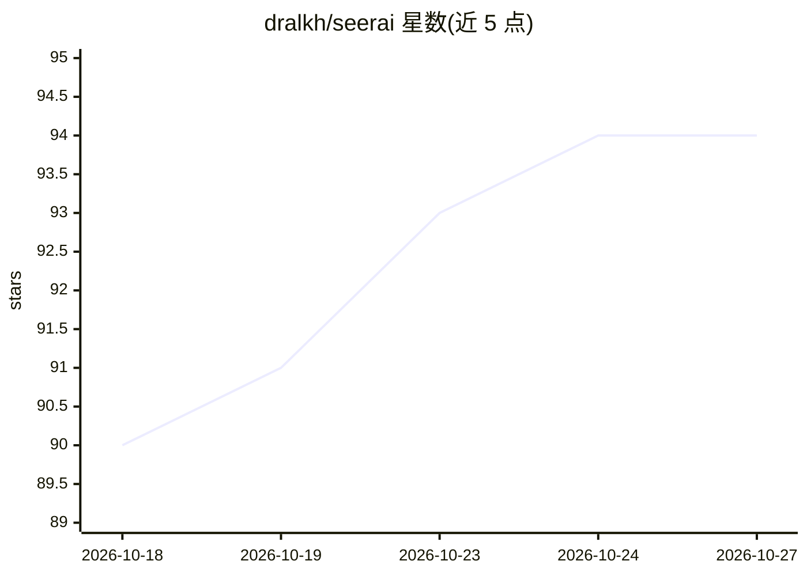

# dralkh/seerai

⭐ 94 · TypeScript · MIT · 推送 2026-10-06 · [GitHub](https://github.com/dralkh/seerai) · 个人维护

**Zotero 9/10 的 AI 研究助手插件：文献对话、检索、RAG 与系统综述**

面向 Zotero 用户的 AI 研究助手插件：与文献库中的论文对话（含视觉与多模态生成）、语义 RAG 检索、跨 11 个学术数据源联邦检索与导入、PRISMA 式系统综述全流程（筛选、AI 辅助数据提取、元分析、森林图）、结构化 Papers Tables 抽取、内置文件工作区（代码编辑器、Git 集成）、云盘接入（Google Drive/Dropbox/Box/OneDrive/Nextcloud）与多引擎 OCR。支持 Agent 工具调用与约 148 个技能包，模型预设覆盖 OpenAI/Anthropic/DeepSeek 等主流 API 及 OpenAI 兼容本地端点。以 .xpi 安装包或源码构建方式安装。

## 筛选速览

| 维度 | 判定 | 备注 |
|---|---|---|
| AI 角色 | `ai-native` | 本体是模型或模型工具 |
| 许可风险 | `permissive` | MIT |
| 部署形态 | `None` |  |
| 模型依赖 | local-ok | 支持本地模型 |
| 硬件要求 | — | 无带数字的原话,不猜 |
| 安装摩擦 | `low` | 无编译、无系统依赖或容器化 |
| 成熟度 | — | 结构信号不足 |

## 能力要点

- 跨 11 个学术数据源联邦检索，AI 改写查询并去重融合排序
- PRISMA 系统综述流程：筛选、AI 数据提取、元分析与森林图
- RAG 向量索引与多源上下文优先级（笔记→索引文本→OCR）
- Agent 工具套件与约 148 个按需加载的技能包

## 适用场景

- 与自己的文献库和 PDF 对话并做多篇论文对比分析
- 做系统综述：检索、筛选、数据提取与元分析一条龙
- 从多个学术数据源批量检索并导入论文到 Zotero

## 场景标签

`科研工具` `文档问答` `RAG` · 领域:知识与检索

## 证据(README 行号)

> L16: **seerai** is an intelligent research assistant plugin for Zotero 9/10 that integrates AI-powered chat, advanced se
> L41: - **Contextual Conversations**: Chat with AI about your selected papers with full context awareness.

## 星数曲线

2026-10-18 90 → 2026-10-27 94（+4）

---
*卡片 v1 · prompt 1.4 · 生成 2026-10-23 · 置信度 high · 依据 README sha `f4099d5d5ce2` · [字段定义](../../DATASET.md)*
