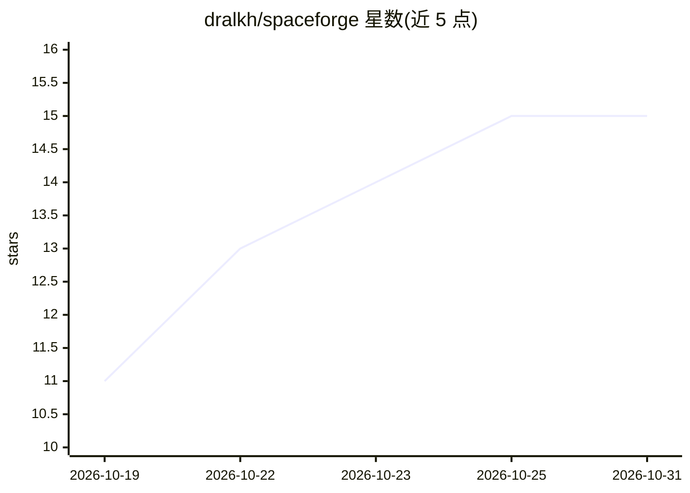

# dralkh/spaceforge

⭐ 15 · TypeScript · MIT · 推送 2026-10-29 · [GitHub](https://github.com/dralkh/spaceforge) · [官网](https://github.com/dralkh/spaceforge) · 个人维护

**Obsidian 间隔重复学习插件：FSRS/SM-2 复习、AI 出题与番茄钟**

面向 Obsidian 用户的学习与记忆管理插件：将笔记转为复习卡片，用 FSRS 或增强 SM-2 算法调度间隔重复；支持调用 OpenAI、OpenRouter、Ollama、Gemini、Claude、Together 等提供商的模型从笔记生成选择题；提供单笔记自适应导师（学习目标拆解、跨会话记忆、可选联网核查）、内置番茄钟、日历事件管理与统计面板。安装途径为 Obsidian 社区插件市场或 git clone 源码构建。

## 筛选速览

| 维度 | 判定 | 备注 |
|---|---|---|
| AI 角色 | `ai-enhanced` | 去掉 AI 部分产品仍成立 |
| 许可风险 | `permissive` | MIT |
| 部署形态 | `None` |  |
| 模型依赖 | local-ok | 支持本地模型 |
| 硬件要求 | — | 无带数字的原话,不猜 |
| 安装摩擦 | `low` | 无编译、无系统依赖或容器化 |
| 成熟度 | — | 结构信号不足 |

## 能力要点

- FSRS 与增强 SM-2 两种间隔重复调度算法，复习时可预览各评分对应间隔
- 调用多家 AI 提供商模型从笔记生成选择题（MCQ）
- 单笔记自适应导师：学习目标拆解、跨会话恢复、可选联网核查
- 内置番茄钟、日历事件管理与全库统计面板（热力图/真实留存率等）

## 适用场景

- 在 Obsidian 内对笔记做间隔重复复习备战考试
- 让 AI 从笔记自动生成选择题进行自测
- 结合番茄钟与日历管理学习计划

## 场景标签

 · 领域:学习/知识管理工具

## 证据(README 行号)

> L3: **Spaceforge: Your ultimate Obsidian plugin for efficient knowledge management, memory retention, and exam preparati
> L22:  * Leverage powerful AI models from various providers: **OpenAI, OpenRouter, Ollama, Gemini, Claude, and Together**

## 星数曲线

2026-10-19 11 → 2026-10-31 15（+4）

---
*卡片 v1 · prompt 1.4 · 生成 2026-10-30 · 置信度 high · 依据 README sha `931cf513614b` · [字段定义](../../DATASET.md)*
