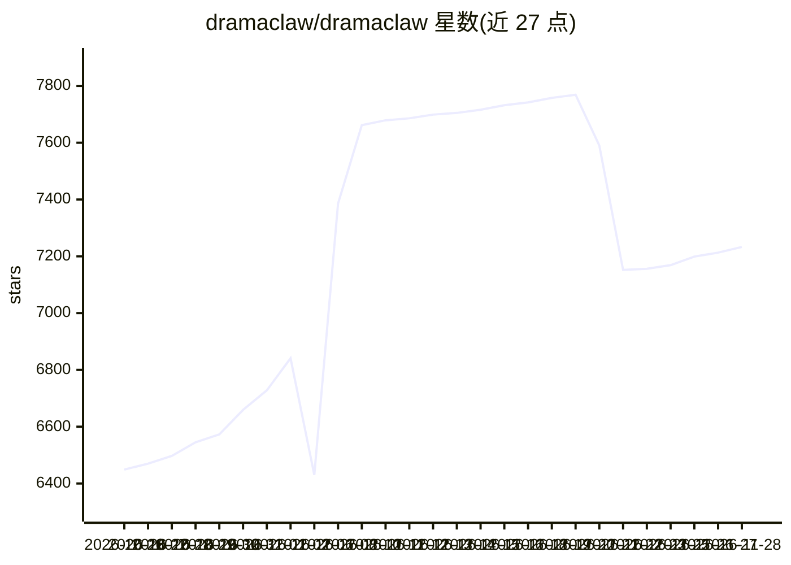

# dramaclaw/dramaclaw

⭐ 7,233 · TypeScript · NOASSERTION · 推送 2026-11-27 · [GitHub](https://github.com/dramaclaw/dramaclaw) · [官网](https://dramaclaw.ai) · 组织维护 · 中文 README

**自托管的 AI 剧集成片流水线，从剧本到成片**

DramaClaw 是可自托管的 AI 剧集/短视频生产流水线，覆盖剧本结构化、分镜、首帧生成、配音、剪辑与导出。核心组件包括 Agent 助手 Xia Director（将自然语言需求规划为画布工作流并执行）、无限画布 XiaHua（图像/视频/音频/3D 节点生成与编辑）与系列流水线 XiaJi（小说或剧本入库后分段推进，支持断点续跑）。模型经 OpenAI 兼容网关接入，推理不在本地运行，无需 GPU 与数据库，状态存于本地磁盘。采用 Elastic License 2.0，独立版可商用但禁止托管 SaaS 转售。

## 筛选速览

| 维度 | 判定 | 备注 |
|---|---|---|
| AI 角色 | `ai-native` | 本体是模型或模型工具 |
| 许可风险 | `none` | NOASSERTION |
| 部署形态 | `self-host` | docker 或自建部署 |
| 模型依赖 | — | README 未给出锁定关系 |
| 硬件要求 | `cpu-ok` | |
| 安装摩擦 | `low` | 无编译、无系统依赖或容器化 |
| 成熟度 | — | 结构信号不足 |

## 能力要点

- Xia Director 将一句话需求规划为画布节点工作流并确认后执行
- XiaHua 无限画布支持图像、视频、音频、3D 场景、交互故事等 17 类节点
- Series 流水线支持 Fountain 剧本摄取、分集规划与断点续跑
- 经 OpenAI 兼容网关接入任意模型，Agent 可经 MCP 暴露给外部客户端

## 适用场景

- 把小说或剧本批量做成带配音字幕的短剧成片
- 在画布上生成和编辑图片、视频、配音等素材并组装成片
- 制作电商广告、IP 角色广告等预设工作流内容
- 用 3D Previz 先确定场景与机位再生成视频

## 场景标签

`工作流自动化` `视频生成` `语音合成` · 领域:效率与自动化

## 证据(README 行号)

> L61: DramaClaw is a **self-hostable production line for AI drama**: from manuscript to finished episodes, and from a one
> L65: - **Series (XiaJi)** — the pipeline. Drop in a novel or screenplay; DramaClaw structures the story, writes scripts,
> L202: - **Video tools** — text / image / keyframe to video, omni-reference generation with file, web-link and on-canvas 

## 星数曲线

2026-10-26 6,449 → 2026-11-28 7,233（+784）

---
*卡片 v1 · prompt 1.4 · 生成 2026-11-28 · 置信度 high · 依据 README sha `dffdd10dedbc` · [字段定义](../../DATASET.md)*
