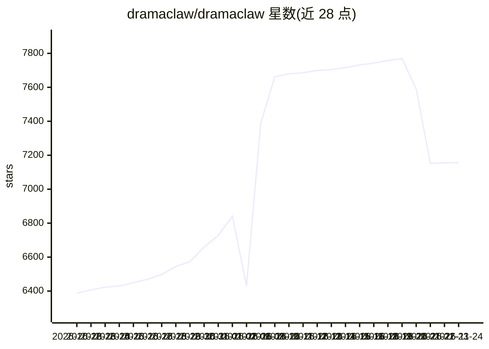

# dramaclaw/dramaclaw

⭐ 7,156 · TypeScript · NOASSERTION · 推送 2026-11-22 · [GitHub](https://github.com/dramaclaw/dramaclaw) · [官网](https://dramaclaw.ai) · 组织维护 · 中文 README

**自托管 AIGC 视频引擎：从剧本到成片一条流水线**

DramaClaw 是可自托管的 AI 短剧生产流水线：内置 Agent「夏导演」把自然语言需求规划为画布工作流并执行，「夏画」无限画布以节点方式生成与编辑图像、视频、音频、3D 场景、交互故事与脚本，「夏剧」流水线从小说或剧本出发完成结构化拆解、分镜、配音与剪辑。模型通过 OpenAI 兼容网关接入，状态存本地磁盘。部署需 Docker Compose，无 GPU 与外部数据库要求；面向想自行运行生产线的创作者。

## 筛选速览

| 维度 | 判定 | 备注 |
|---|---|---|
| AI 角色 | `ai-native` | 本体是模型或模型工具 |
| 许可风险 | `none` | NOASSERTION |
| 部署形态 | `self-host` | docker 或自建部署 |
| 模型依赖 | — | README 未给出锁定关系 |
| 硬件要求 | `cpu-ok` | |
| 安装摩擦 | `low` | 无编译、无系统依赖或容器化 |
| 成熟度 | — | 结构信号不足 |

## 能力要点

- Agent 规划并执行画布工作流，支持导入外部 SKILL.md/ZIP 技能包
- 无限画布统一承载图像、视频、音频、3D Previz、交互故事等节点
- Series 流水线支持剧本摄取、分集规划、分镜生成与视频+字幕导出
- 模型经 OpenAI 兼容网关接入，可切换自有 provider

## 适用场景

- 从小说或剧本批量生成短剧成片并导出资产包
- 在画布上编排图像/视频/音频节点制作广告与电商内容
- 制作带分支选择的互动故事并导出独立 HTML 播放器

## 场景标签

`视频生成` `语音合成` `图像生成` · 领域:内容生成

## 证据(README 行号)

> L61: DramaClaw is a **self-hostable production line for AI drama**: from manuscript to finished episodes, and from a one
> L63: - **Xia Director** — the built-in agent. Describe what you want; it plans the workflow, lays out the nodes and runs
> L154: You need Docker with `docker compose`. No GPU, database or queue is required — models run behind the gateway, stat

## 星数曲线

2026-10-22 6,387 → 2026-11-24 7,156（+769）

---
*卡片 v1 · prompt 1.4 · 生成 2026-11-22 · 置信度 high · 依据 README sha `f19ada5d1fa7` · [字段定义](../../DATASET.md)*
