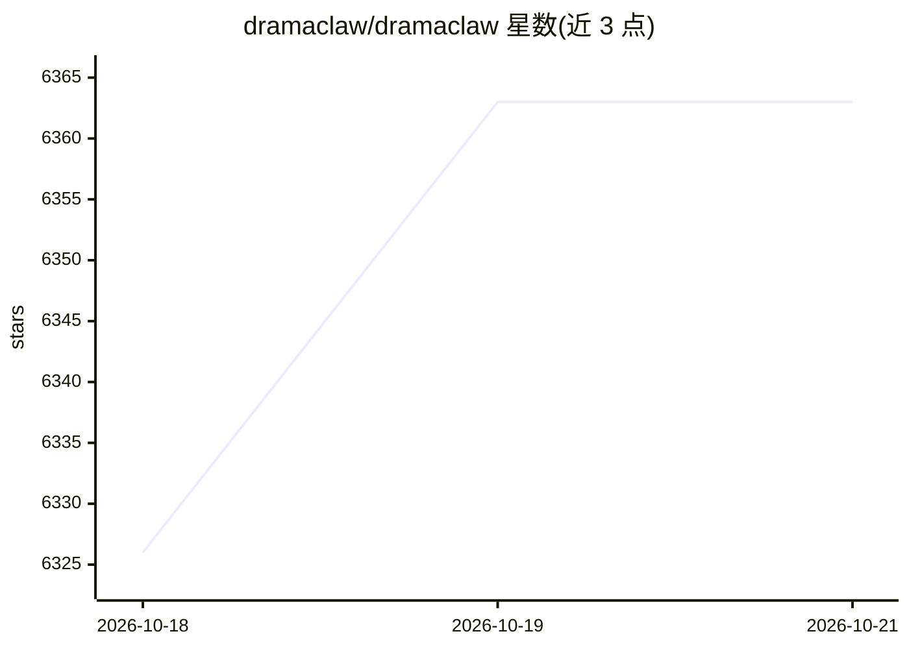

# dramaclaw/dramaclaw

⭐ 6,363 · Python · NOASSERTION · 推送 2026-10-19 · [GitHub](https://github.com/dramaclaw/dramaclaw) · [官网](https://dramaclaw.ai) · 组织维护 · 中文 README

**开源可自部署的 AIGC 视频生产引擎：从剧本到成片**

面向创作者、独立工作室与创意工程师的 AIGC 视频生产流水线，可在本机运行。两条主线共享同一资产库与同一 agent：XiaHua 无限画布（18 种节点类型，自由连接图像/视频/音频/3D 节点）与 XiaJi 剧集流水线（从剧本结构化入库、分集规划、剧本生成、分镜首帧、配音到成片导出，支持断点续跑）。内置 Xia Director agent 接收自然语言创意简报并生成、执行画布工作流，含 11 个技能与 60 个配方；另通过 Agent Kit 暴露工作流给 MCP 客户端。3D 预演与互动故事为封闭测试功能。采用 Elastic License 2.0，独立版可免费商用但禁止封装为托管 SaaS，需保留 Power 标识。

## 筛选速览

| 维度 | 判定 | 备注 |
|---|---|---|
| AI 角色 | `ai-native` | 本体是模型或模型工具 |
| 许可风险 | `none` | NOASSERTION |
| 部署形态 | `self-host` | docker 或自建部署 |
| 模型依赖 | — | README 未给出锁定关系 |
| 硬件要求 | — | 无带数字的原话,不猜 |
| 安装摩擦 | `low` | 无编译、无系统依赖或容器化 |
| 成熟度 | `idea` | |

## 能力要点

- 剧本→分集规划→剧本→分镜首帧→配音→成片导出的完整流水线，支持跳步与断点续跑
- XiaHua 画布提供 18 种节点类型与图像生成/编辑、视频生成、音频等工具
- Xia Director agent 从自然语言简报生成并执行画布工作流（11 技能 / 60 配方）
- Director World：图像生成 3D Gaussian Splat 场景以保持跨镜头空间一致性

## 适用场景

- 网文改编短剧的批量生产
- 在画布上自由探索后把成果提交回剧集流水线
- 制作广告、电商产品视频等非短剧内容
- 让 AI agent 按自然语言指令编排和执行生产工作流

## 场景标签

`视频生成` `图像生成` · 领域:内容生成

## 证据(README 行号)

> L93: DramaClaw is a **source-available production line for AI drama** — and, increasingly, for any visual story you want
> L96: - **Series (XiaJi) — the pipeline.** Drop in a manuscript or screenplay and DramaClaw takes over the heavy lifting:
> L100: It's built for creators, indie studios and creative engineers — run the whole "drama factory" on your own machine,

## 星数曲线

2026-10-18 6,326 → 2026-10-21 6,363（+37）

---
*卡片 v1 · prompt 1.4 · 生成 2026-10-20 · 置信度 mid · 依据 README sha `9ab7318b8d76` · [字段定义](../../DATASET.md)*
