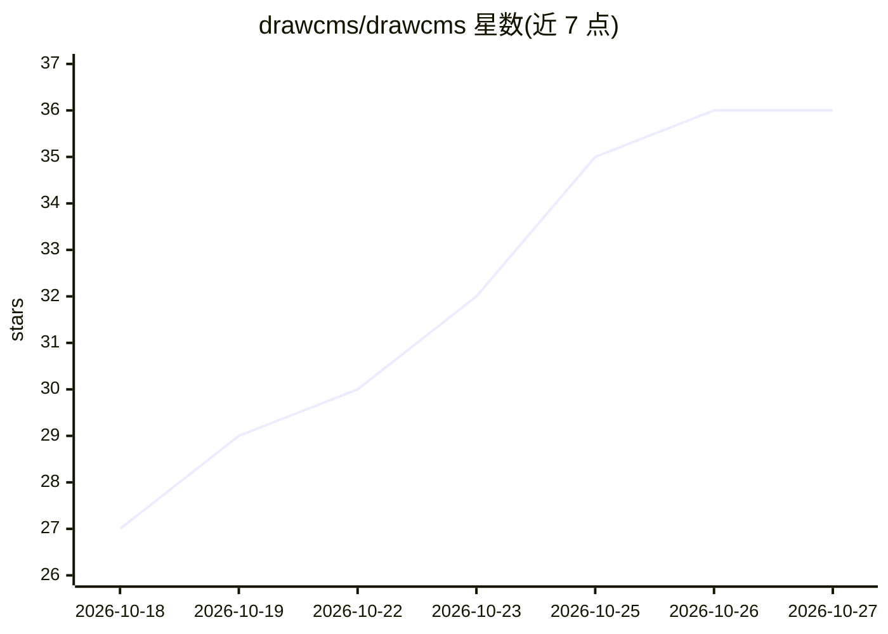

# drawcms/drawcms

⭐ 36 · TypeScript · AGPL-3.0 · 推送 2026-09-24 · [GitHub](https://github.com/drawcms/drawcms) · [官网](https://drawcms.com) · 组织维护

**供人与 AI agent 共同绘制的动画技术图编辑器（WebMCP）**

本地优先的 Web 端技术图编辑器（Next.js 单项目），支持 17 种图类型（架构、时序、BPMN、ER、网络等）、75 个调色板元素、动效预设与演示步骤，导出 PNG/GIF 或便携 .drawcms 文件，浏览器本地存储、无需账号。AI 侧通过 WebMCP（navigator.modelContext）与 agent skill 接入：agent 可在用户同一画布上布局、编辑、配动画、写叙述并按视觉语法校验，兼容 Claude Code、Codex CLI、Cursor、OpenCode。自述非通用绘图工具、非 Mermaid 渲染器。

## 筛选速览

| 维度 | 判定 | 备注 |
|---|---|---|
| AI 角色 | `ai-enhanced` | 去掉 AI 部分产品仍成立 |
| 许可风险 | `viral` | AGPL-3.0 |
| 部署形态 | `library` | 以包/库形式分发 |
| 模型依赖 | — | README 未给出锁定关系 |
| 硬件要求 | — | 无带数字的原话,不猜 |
| 安装摩擦 | `low` | 无编译、无系统依赖或容器化 |
| 成熟度 | — | 结构信号不足 |

## 能力要点

- 17 种图类型、75 个调色板元素与 18 个自带动效的模板
- WebMCP 工具集（9 个工具）：布局/批量编辑/动画/叙述/校验，agent 编辑与手动编辑共享撤销栈
- 单一 .drawcms 便携文件携带动效与叙述，可导出 PNG/GIF
- 本地优先：浏览器自动保存，无账号、无服务器、无 API key

## 适用场景

- 让 AI agent 根据文字描述生成可逐步讲解的动画架构图/时序图
- 在仓库讲解、方案评审中导出带动画与叙述的图示
- 与 agent 在同一画布上协作编辑并逐步叙述系统行为

## 场景标签

 · 领域:开发者工具/图表可视化

## 证据(README 行号)

> L1: DrawCMS — a canvas for your AI agent. Architecture, workflows, and sequences: create, animate, share.
> L147: The editor registers a WebMCP toolset with the browser's native `navigator.modelContext` API. In an agent-capable 
> L129: DrawCMS is not a general-purpose drawing tool and not a Mermaid renderer. It exists to turn a system you understan

## 星数曲线

2026-10-18 27 → 2026-10-27 36（+9）

---
*卡片 v1 · prompt 1.4 · 生成 2026-10-25 · 置信度 high · 依据 README sha `451a8a2d476b` · [字段定义](../../DATASET.md)*
