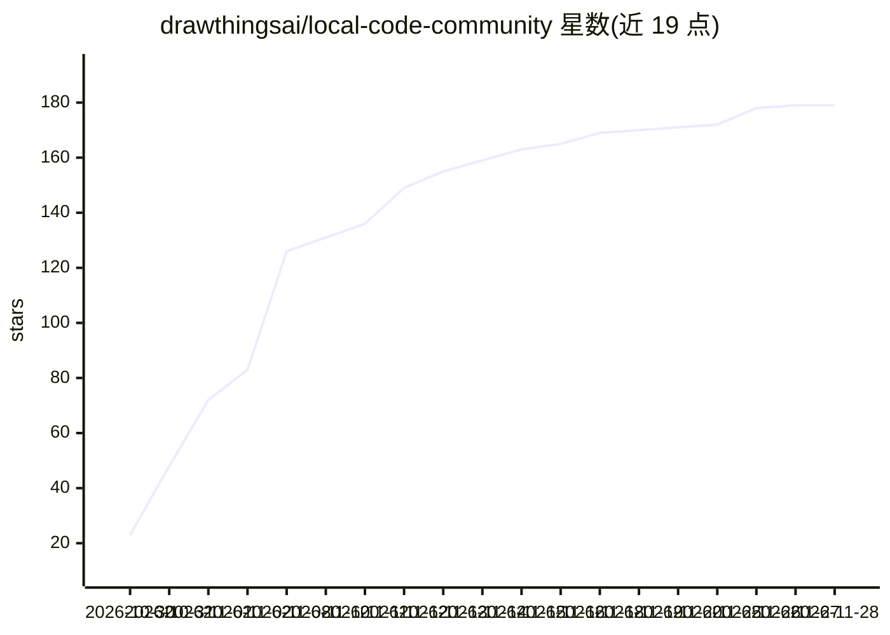

# drawthingsai/local-code-community

⭐ 179 · C · GPL-3.0 · 推送 2026-11-27 · [GitHub](https://github.com/drawthingsai/local-code-community) · [官网](https://getlocalcode.app) · 组织维护

**Mac/iPad/iPhone 上的本地私有 AI 编码代理应用**

用 Swift 编写的私有 AI agent 应用，将 Apple Silicon 上的 LLM 推理引擎、按模型调优的编码 harness 与内置 Python/Node.js/shell 的 agent 运行时合于一体。代理可在用户指定的工作区文件夹内完成任务：数据分析、制图、写文档与幻灯片、开发软件。支持离线运行设备端量化模型，也可接入 Anthropic、OpenAI、OpenRouter 或 OpenAI 兼容云端服务；工具在 App Sandbox 内运行，仅能访问用户授权的文件夹。应用从 getlocalcode.app 下载，本仓库为其源码。

## 筛选速览

| 维度 | 判定 | 备注 |
|---|---|---|
| AI 角色 | `ai-native` | 本体是模型或模型工具 |
| 许可风险 | `viral` | GPL-3.0 |
| 部署形态 | `None` |  |
| 模型依赖 | — | README 未给出锁定关系 |
| 硬件要求 | — | 无带数字的原话,不猜 |
| 安装摩擦 | `medium` | 含编译或系统依赖之一 |
| 成熟度 | — | 结构信号不足 |

## 能力要点

- Apple Silicon 设备端量化推理，支持离线运行
- 内置 Python 3.14、Node.js 24、OSH shell 及 LibreOffice/FFmpeg 等工具的沙箱运行时
- 按设备内存建议模型，大 MoE 模型采用权重流式加载（内存-32GB 上限）
- 支持草稿模型投机解码与持久化上下文缓存，附 M5 Max/Ultra 性能数据

## 适用场景

- 在 Mac 上离线运行 AI 编码代理处理本地项目文件
- 让代理分析数据、生成图表、撰写文档和幻灯片
- 在 iPhone/iPad 上运行小型本地模型执行代理任务
- 接入 OpenAI 兼容云端服务使用更大的模型

## 场景标签

`编码 Agent` `数据分析` · 领域:效率与自动化

## 证据(README 行号)

> L3: Local Code is a private AI agent for Mac, iPad and iPhone, written mostly in Swift. It puts three things in one app:
> L5: With an on-device quasi-frontier model, such as DeepSeek 4.1 Flash 1017, inference runs on your device and works off

## 星数曲线

2026-10-30 23 → 2026-11-28 179（+156）

---
*卡片 v1 · prompt 1.4 · 生成 2026-11-28 · 置信度 high · 依据 README sha `c679d9b9d2b9` · [字段定义](../../DATASET.md)*
