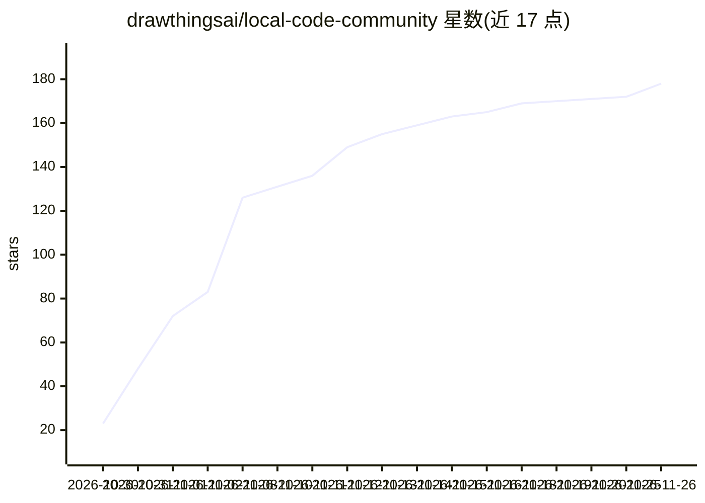

# drawthingsai/local-code-community

⭐ 178 · C · GPL-3.0 · 推送 2026-11-25 · [GitHub](https://github.com/drawthingsai/local-code-community) · [官网](https://getlocalcode.app) · 组织维护

**面向 Mac/iPad/iPhone 的本地运行 AI 编码代理应用**

以 Swift 编写的私有 AI 代理应用，将 Apple Silicon 上的 LLM 推理引擎、按模型调优的编码 harness 与内置 Python、Node.js、shell 的代理运行时整合进一个应用，可对用户选定的文件执行数据分析、图表绘制、文档与幻灯片生成、软件开发等任务。模型默认在设备上量化运行、支持离线；也可切换到 Anthropic、OpenAI、OpenRouter 或 OpenAI 兼容服务器等云端模型，此时提示词与文件内容会发送给该服务商。代理工具运行在应用沙箱内，仅能访问用户授权的文件夹。安装通过官网下载，仓库提供应用与命令行工具的源码。

## 筛选速览

| 维度 | 判定 | 备注 |
|---|---|---|
| AI 角色 | `ai-native` | 本体是模型或模型工具 |
| 许可风险 | `viral` | GPL-3.0 |
| 部署形态 | `None` |  |
| 模型依赖 | locked-api |  |
| 硬件要求 | — | 无带数字的原话,不猜 |
| 安装摩擦 | `medium` | 含编译或系统依赖之一 |
| 成熟度 | — | 结构信号不足 |

## 能力要点

- 内置 Apple Silicon LLM 推理引擎，下载量化 checkpoint 在设备上运行并支持离线
- 沙箱内置 Shell、Python 3.14、Node.js 24、Lean 4/Z3、LibreOffice、FFmpeg 等工具
- 支持持久任务与线程、可续写的生成、随时转向、磁盘上下文缓存
- 支持添加自定义 skills 与通过 MCP 连接外部工具

## 适用场景

- 让代理在本机沙箱中完成数据分析并生成图表与文档
- 在无网络环境下离线运行本地模型处理编码任务
- 用云端模型时保持工具在沙箱内运行、限制文件访问范围

## 场景标签

`编码 Agent` `AI 助手` `数据分析` `推理引擎` · 领域:效率与自动化

## 证据(README 行号)

> L3: Local Code is a private AI agent for Mac, iPad and iPhone, written mostly in Swift. It puts three things in one app:
> L5: With an on-device quasi-frontier model, such as DeepSeek 4.1 Flash 1017, inference runs on your device and works off
> L7: Download Local Code from getlocalcode.app.

## 星数曲线

2026-10-30 23 → 2026-11-26 178（+155）

---
*卡片 v1 · prompt 1.4 · 生成 2026-11-26 · 置信度 mid · 依据 README sha `5846e25bf020` · [字段定义](../../DATASET.md)*
