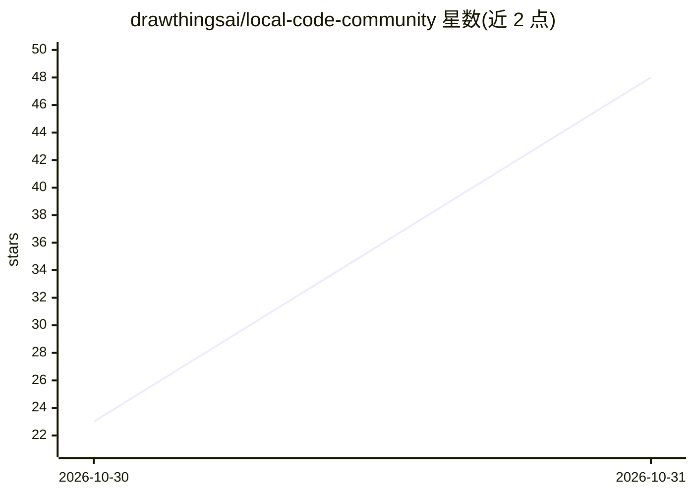

# drawthingsai/local-code-community

⭐ 48 · C · GPL-3.0 · 推送 2026-10-30 · [GitHub](https://github.com/drawthingsai/local-code-community) · [官网](https://getlocalcode.app) · 组织维护

**Mac/iPad/iPhone 上的本地 AI 编码代理应用**

主要由 Swift 编写的 Apple 平台 AI 代理应用，整合 Apple Silicon 本地 LLM 推理引擎、按模型调优的编码 harness 和带 Python 3.14、Node.js 24、OSH shell 的代理运行时，在 App Sandbox 内处理数据分析、绘图、文档/幻灯片制作与软件开发等任务。可离线运行 DeepSeek 4.1 Flash、DeepSeek 4 Flash、Qwen 3.8 27B 的量化版本，也可切换 Anthropic、OpenAI、OpenRouter 或 OpenAI 兼容服务器的云端模型。DeepSeek 模型以专家流式加载方式在小于检查点内存的 Mac 上运行。含仓库源码与命令行工具，应用本体从官网下载。

## 筛选速览

| 维度 | 判定 | 备注 |
|---|---|---|
| AI 角色 | `ai-native` | 本体是模型或模型工具 |
| 许可风险 | `viral` | GPL-3.0 |
| 部署形态 | `None` |  |
| 模型依赖 | locked-api |  |
| 硬件要求 | — | 无带数字的原话,不猜 |
| 安装摩擦 | `medium` | 含编译或系统依赖之一 |
| 成熟度 | — | 结构信号不足 |

## 能力要点

- 内置 Python、Node.js、shell、Lean 4/Z3、LibreOffice 等工具的沙箱化代理运行时
- DeepSeek MoE 模型按可用内存保留常用专家、其余从磁盘流式读取
- 支持持久任务线程、可恢复生成、长期上下文缓存
- 可切换 Anthropic/OpenAI/OpenRouter/OpenAI 兼容云端模型

## 适用场景

- 在 Mac/iPad/iPhone 上离线运行 AI 代理完成文件任务
- 让代理在沙箱内做数据分析、绘图、写文档与开发软件
- 通过 MCP（MCPorter）连接外部工具服务器

## 场景标签

`编码 Agent` `数据分析` `AI 助手` · 领域:效率与自动化

## 证据(README 行号)

> L3: Local Code is a private AI agent for Mac, iPad and iPhone, written mostly in Swift. It puts three things in one app:
> L5: With an on-device quasi-frontier model, such as DeepSeek 4.1 Flash 1017, inference runs on your device and works off

## 星数曲线

2026-10-30 23 → 2026-10-31 48（+25）

---
*卡片 v1 · prompt 1.4 · 生成 2026-10-30 · 置信度 high · 依据 README sha `7d52e3327ec0` · [字段定义](../../DATASET.md)*
