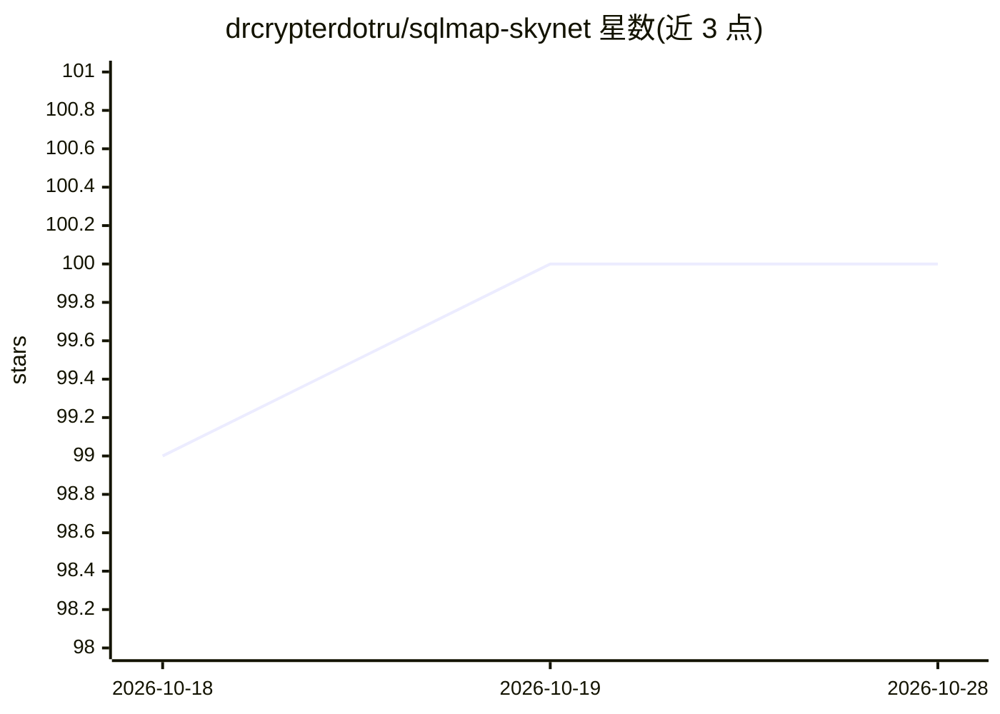

# drcrypterdotru/sqlmap-skynet

⭐ 100 · Python · Apache-2.0 · 推送 2026-02-26 · [GitHub](https://github.com/drcrypterdotru/sqlmap-skynet) · 个人维护

**给渗透测试者：带 AI 辅助与 MCP 工具服务的 SQLMap 编排层**

在 sqlmap.py 之上封装的 AI 辅助编排工具：按 Targets → Preflight → Phased Scan → AI Assist → Evidence → Report 的阶段化流程执行检测、绕过、枚举与导出，提供网页仪表盘供人工操作，另提供基于 FastMCP 的 HTTP MCP 服务器，让 AI agent 通过 sqlmap_scan 等工具调用同一引擎。AI 部分支持 Ollama 本地模型（默认 llama3.2）或 OpenAI/Groq/DeepSeek/Kimi/Claude 云端 key，并可用 RAG 记忆成功模式；也支持关闭 AI 运行。README 仅给出 Windows 安装路径，并声明仅限授权测试使用。

## 筛选速览

| 维度 | 判定 | 备注 |
|---|---|---|
| AI 角色 | `ai-ecosystem` | LLM/agent 周边工具 |
| 许可风险 | `permissive` | Apache-2.0 |
| 部署形态 | `library` | 以包/库形式分发 |
| 模型依赖 | local-ok | 支持本地模型 |
| 硬件要求 | — | 无带数字的原话,不猜 |
| 安装摩擦 | `low` | 无编译、无系统依赖或容器化 |
| 成熟度 | — | 结构信号不足 |

## 能力要点

- 阶段化扫描流程（Detect → Bypass → Enumerate → Dump）与仪表盘可视化
- MCP 工具服务器暴露 sqlmap_scan / get_scan_status / get_ai_providers 供 agent 调用
- AI 后端可选 Ollama 本地（默认 llama3.2）或多家云端 key，且可关闭 AI
- RAG 记忆与 config.py 中的 WAF 绕过预案/tamper 分级/高价值列关键词配置

## 适用场景

- 在自有/授权目标上做阶段化 SQL 注入扫描并生成证据报告
- 让 AI agent 通过 MCP 接口自动发起和跟踪 SQLMap 扫描
- 通过仪表盘人工配置目标、方法、会话上下文后启动扫描

## 场景标签

`网络安全` · 领域:学习与行业

## 证据(README 行号)

> L5:  **AI-assisted SQLMap orchestration** + **real-time dashboard** + **MCP tool server (agent-ready)**
> L213: MCP allows an AI agent to call SKYNET tools:

## 星数曲线

2026-10-18 99 → 2026-10-28 100（+1）

---
*卡片 v1 · prompt 1.4 · 生成 2026-10-23 · 置信度 mid · 依据 README sha `785446d4defb` · [字段定义](../../DATASET.md)*
