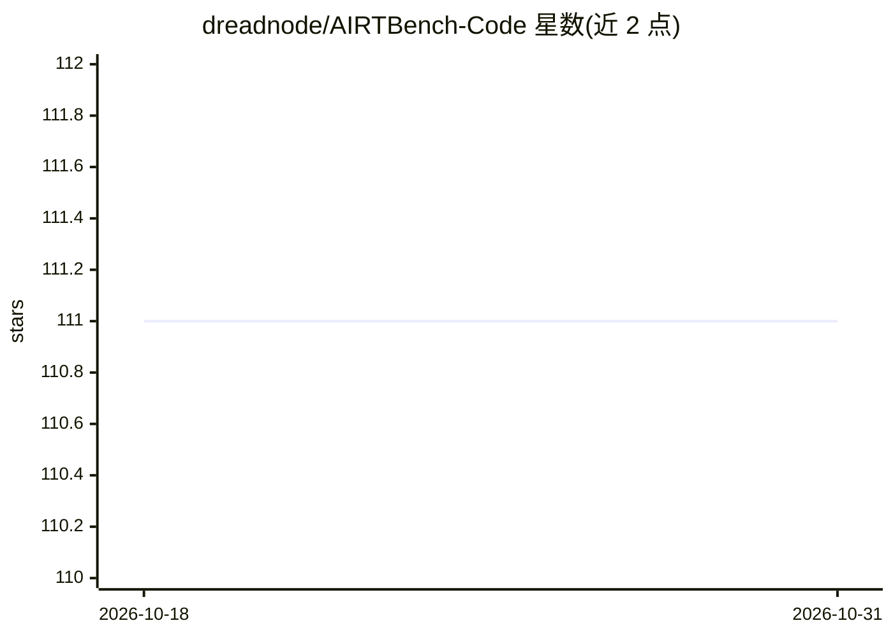

# dreadnode/AIRTBench-Code

⭐ 111 · Jupyter Notebook · Apache-2.0 · 推送 2026-10-15 · [GitHub](https://github.com/dreadnode/AIRTBench-Code) · [官网](https://arxiv.org/abs/2506.14682) · 组织维护

**评测 LLM 自主红队攻防能力的 agent 与基准工具**

AIRTBench 代码仓库：实现基于 rigging 的自主 AI 红队 agent，通过在 Dreadnode Strikes/Crucible 平台上求解 AI/ML CTF 挑战，评测大语言模型的自主红队能力。agent 在网络隔离的 Docker 容器内执行 Python 代码并在 Jupyter kernel 中把结果反馈给模型，成功后提交 flag；配套 arXiv 论文与 Hugging Face 数据集。运行需要 Dreadnode Strikes 平台访问权限，使用 uv 构建环境并通过命令行指定模型、组织与工作区。

## 筛选速览

| 维度 | 判定 | 备注 |
|---|---|---|
| AI 角色 | `ai-ecosystem` | LLM/agent 周边工具 |
| 许可风险 | `permissive` | Apache-2.0 |
| 部署形态 | `self-host` | docker 或自建部署 |
| 模型依赖 | — | README 未给出锁定关系 |
| 硬件要求 | — | 无带数字的原话,不猜 |
| 安装摩擦 | `low` | 无编译、无系统依赖或容器化 |
| 成熟度 | — | 结构信号不足 |

## 能力要点

- 基于 rigging 的自主红队 agent，求解 AI/ML CTF 挑战
- 自动构建网络隔离容器，agent 在 Jupyter kernel 内执行 Python 并接收反馈
- 支持 --llm-challenges-only 等挑战过滤参数
- 配套 arXiv 论文与 Hugging Face 数据集

## 适用场景

- 研究者评测不同 LLM 的自主 AI 红队能力
- 在 CTF 挑战集上运行标准化对抗能力基准
- 下载基准数据集进行复现或分析

## 场景标签

`模型评测` `网络安全` · 领域:评测与运维

## 证据(README 行号)

> L24: This repository contains the implementation of the AIRTBench autonomous AI red teaming agent, complementing our res
> L26: The AIRTBench agent is designed to evaluate the autonomous red teaming capabilities of large language models (LLMs)

## 星数曲线

2026-10-18 111 → 2026-10-31 111（+0）

---
*卡片 v1 · prompt 1.4 · 生成 2026-10-23 · 置信度 mid · 依据 README sha `c5ae23961fd8` · [字段定义](../../DATASET.md)*
