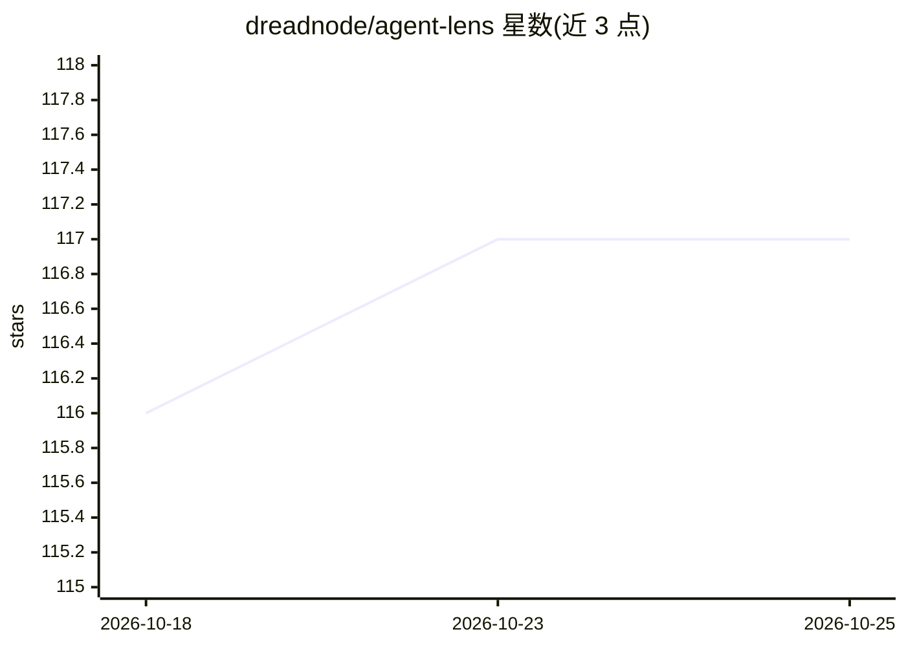

# dreadnode/agent-lens

⭐ 117 · Python · MIT · 推送 2026-06-19 · [GitHub](https://github.com/dreadnode/agent-lens) · [官网](https://dreadnode.github.io/agent-lens/) · 组织维护

**AI 安全研究用的多会话 agent 轨迹采集与重放工具**

面向 AI 对齐与可解释性研究的实验 harness：用 YAML 配置在 Claude Code（Claude Agent SDK）与 OpenAI Codex 两个引擎上运行多会话 agent 轨迹，输出 ATIF 标准化 JSON，记录每步工具调用、观察与思考块；通过不可见 shadow git 自动追踪文件变更并提供逐步写入归因与完整 diff。支持 isolated/chained/forked 三种会话链模式、多级重采样与干预实验、子 agent 轨迹捕获及可配置后端的 LLM 自动评审。安装需 Python 3.12 与 uv，从源码克隆构建；部分功能（如 turn-level replay）标注为实验性。

## 筛选速览

| 维度 | 判定 | 备注 |
|---|---|---|
| AI 角色 | `ai-ecosystem` | LLM/agent 周边工具 |
| 许可风险 | `permissive` | MIT |
| 部署形态 | `self-host` | docker 或自建部署 |
| 模型依赖 | locked-api |  |
| 硬件要求 | — | 无带数字的原话,不猜 |
| 安装摩擦 | `low` | 无编译、无系统依赖或容器化 |
| 成熟度 | `idea` | |

## 能力要点

- ATIF 格式轨迹捕获：每步、工具调用、观察与思考块
- shadow git 隐形追踪文件变更，逐步写入归因与统一 diff
- isolated/chained/forked 会话链模式与 fork_from 灵活分叉
- 多级重采样、干预测试与任意分支点的 turn-level 重放

## 适用场景

- 研究 LLM agent 在多轮、多会话、多 agent 交互中的行为
- 对同一会话做重复采样以研究行为方差
- 编辑助手文本或工具结果后重放，做干预实验
- 用 LLM judge 按 rubric 评估运行中的轨迹

## 场景标签

`LLM 可观测性` `科研工具` · 领域:评测与运维

## 证据(README 行号)

> L7: Built for AI alignment and interpretability research — studying how LLM agents behave across multi-turn, multi-sessi
> L15: The harness takes a YAML config describing a sequence of sessions (prompts to an agent), runs each session against 

## 星数曲线

2026-10-18 116 → 2026-10-25 117（+1）

---
*卡片 v1 · prompt 1.4 · 生成 2026-10-23 · 置信度 mid · 依据 README sha `1d049a31c005` · [字段定义](../../DATASET.md)*
