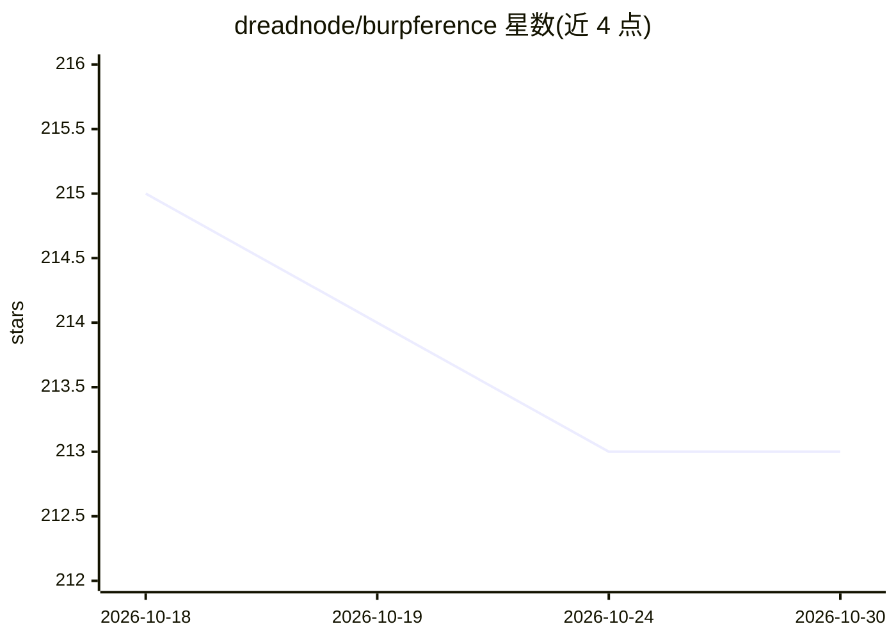

# dreadnode/burpference

⭐ 213 · Python · Apache-2.0 · 推送 2026-02-16 · [GitHub](https://github.com/dreadnode/burpference) · [官网](https://dreadnode.io) · 组织维护

**Burp Suite 扩展：将代理流量发送给 LLM 做攻击性安全分析**

Jython 编写的 Burp Suite 扩展，捕获 Burp 代理历史中符合作用域的 HTTP 请求/响应，打包为 JSON 发送至远程 LLM API（支持多家模型提供商及自定义 API 配置，可经 Ollama 本地运行模型）。LLM 作为攻击性 Web 测试 agent 输出按严重级别分级的发现，以彩色标签与 Burp Scanner issue 形式呈现。另含扫描器页签（URL/OpenAPI 分析、安全头评估）、日志系统、持久化 findings 存储。需 Burp Suite 与 Jython standalone jar，本地模型场景下系统资源占用较高（README 自述）。

## 筛选速览

| 维度 | 判定 | 备注 |
|---|---|---|
| AI 角色 | `ai-ecosystem` | LLM/agent 周边工具 |
| 许可风险 | `permissive` | Apache-2.0 |
| 部署形态 | `None` |  |
| 模型依赖 | local-ok | 支持本地模型 |
| 硬件要求 | — | 无带数字的原话,不猜 |
| 安装摩擦 | `low` | 无编译、无系统依赖或容器化 |
| 成熟度 | — | 结构信号不足 |

## 能力要点

- 自动捕获作用域内 HTTP 流量并以 JSON 发送至配置的 LLM API
- 支持多模型提供商配置及 Ollama 本地模型（含 HuggingFace GGUF）
- 扫描器页签支持 URL/OpenAPI 规格分析与安全头实时评估
- findings 持久化至 logs/findings.json 并同步至 Burp Scanner issues

## 适用场景

- 渗透测试中让 LLM 分析代理流量并按严重度提示发现
- 对目标端点与 OpenAPI 规格做安全分析
- 通过 Ollama 本地运行模型以规避 API 成本与限流

## 场景标签

`网络安全` · 领域:学习与行业

## 证据(README 行号)

> L20: "_burpference_" started as a research idea of offensive agent capabilities and is a fun take on Burp Suite and runn
> L24: - **Automated Response Capture**: Burp Suite acts as your client monitor, automatically capturing responses that fa

## 星数曲线

2026-10-18 215 → 2026-10-30 213（-2）

---
*卡片 v1 · prompt 1.4 · 生成 2026-10-22 · 置信度 high · 依据 README sha `5882cb464b87` · [字段定义](../../DATASET.md)*
