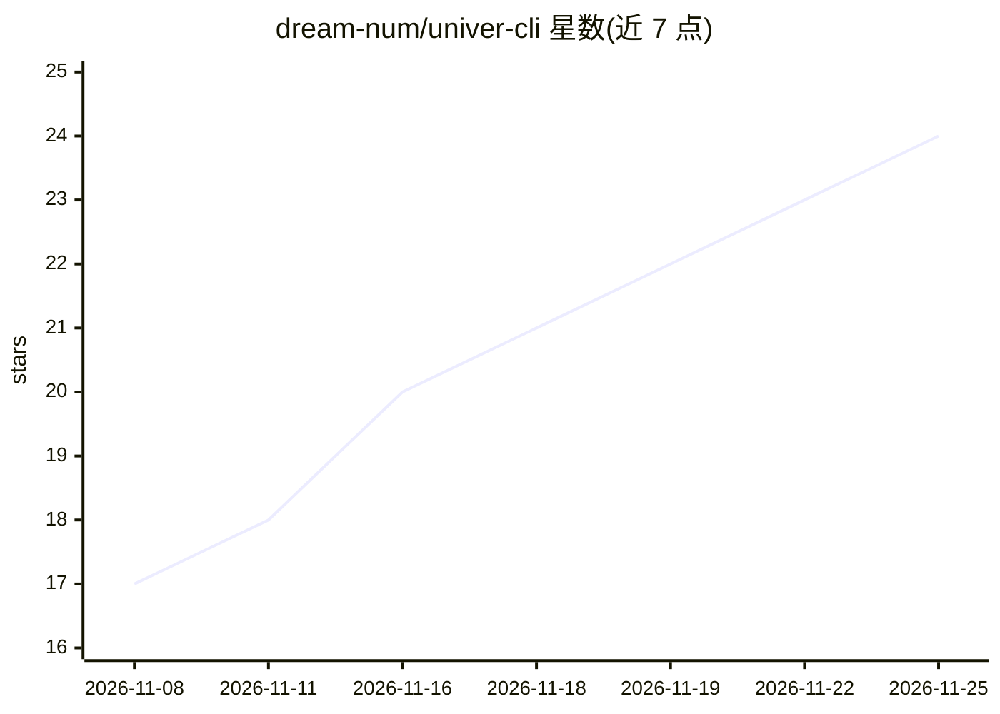

# dream-num/univer-cli

⭐ 24 · TypeScript · Apache-2.0 · 推送 2026-11-23 · [GitHub](https://github.com/dream-num/univer-cli) · [官网](https://univer.ai) · 组织维护 · 中文 README

**给 AI agent 用的本地 Office 命令行工具：创建/编辑/审阅文档表格幻灯片**

基于 Univer Office SDK 构建的本地优先命令行应用：AI agent 通过安装官方 univer-cli Skill，创建与编辑电子表格、文档、演示文稿、多维表格和画布，并可导入导出 Excel/Word/PowerPoint/CSV 等格式。所有修改在隔离的 Worktree 草稿中进行，agent 通过 Univer Facade 执行编辑、读取存储模型、截图或运行布局 lint 验证，完成后返回本地 Viewer URL 供用户查看并决定合并或放弃。数据存储于本地 SQLite 的 .univer 文件，文件与 Gateway、Viewer、daemon 均留在本机。需要支持 Agent Skills 的 agent、Node.js 24+ 及 npm/npx；截图、PDF 打印与部分 lint 需 Chrome/Chromium/Edge。

## 筛选速览

| 维度 | 判定 | 备注 |
|---|---|---|
| AI 角色 | `ai-ecosystem` | LLM/agent 周边工具 |
| 许可风险 | `permissive` | Apache-2.0 |
| 部署形态 | `library` | 以包/库形式分发 |
| 模型依赖 | — | README 未给出锁定关系 |
| 硬件要求 | — | 无带数字的原话,不猜 |
| 安装摩擦 | `low` | 无编译、无系统依赖或容器化 |
| 成熟度 | — | 结构信号不足 |

## 能力要点

- 支持 Sheet/Doc/Slide/Base/Board 五类内容的创建、编辑、检查与导入导出
- 隔离 Worktree 草稿机制：修改经用户审阅后才能合并或放弃
- 提供截图、PDF 打印、布局 lint 等验证手段与本地 Viewer 比对视图
- 40 余个 CLI 命令覆盖文件管理、内容读写、编译 Markdown/Typst/SVG、诊断维护等

## 适用场景

- 让 agent 按自然语言描述生成带公式、图表与条件格式的电子表格
- 让 agent 编辑现有 Excel/Word/PowerPoint 文件并导出标准格式
- 在草稿中隔离审阅 agent 的文档改动，通过差异比对后合并

## 场景标签

`文档解析` · 领域:知识与检索

## 证据(README 行号)

> L12: Univer CLI is a local-first Office CLI for agents. Install the official `univer-cli` Skill, describe the result you
> L144: Univer CLI is built on the Univer SDK. This repository assembles the SDK into a local Office CLI for agents and im
> L136: - An agent that supports Agent Skills, plus Node.js 24.0 or later and npm/npx.

## 星数曲线

2026-11-08 17 → 2026-11-25 24（+7）

---
*卡片 v1 · prompt 1.4 · 生成 2026-11-18 · 置信度 high · 依据 README sha `accf5d6b5ad1` · [字段定义](../../DATASET.md)*
