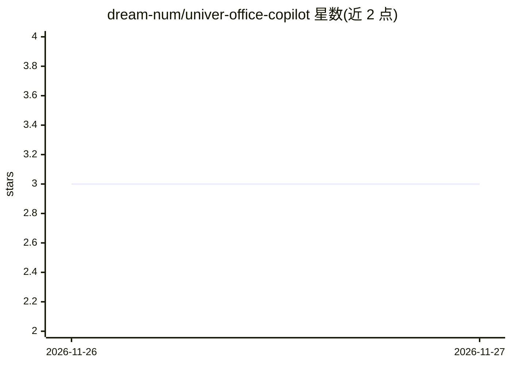

# dream-num/univer-office-copilot

⭐ 3 · TypeScript · Apache-2.0 · 推送 2026-11-05 · [GitHub](https://github.com/dream-num/univer-office-copilot) · [官网](https://univer.ai) · 组织维护

**开发者的可运行 Office Copilot 参考应用，接入自有模型**

基于 Univer Office SDK、LangChain、React 与 TypeScript 构建的参考应用：提供 Sheets、Docs、Slides、Base、Board 五种编辑界面与六个可编辑示例文件。Copilot 读取当前文件、运行后端编辑工具并校验结果，Ask 模式解释内容，Edit 模式直接修改文件；代理编辑与人工编辑走同一协作通道，支持原生历史版本恢复。需 Node.js 24+ 与 pnpm，浏览示例无需 AI key、Docker 或外部数据库，使用 Copilot 需自行配置模型与 key；渲染检查需本地 Chrome/Chromium/Edge。

## 筛选速览

| 维度 | 判定 | 备注 |
|---|---|---|
| AI 角色 | `ai-enhanced` | 去掉 AI 部分产品仍成立 |
| 许可风险 | `permissive` | Apache-2.0 |
| 部署形态 | `library` | 以包/库形式分发 |
| 模型依赖 | locked-api |  |
| 硬件要求 | — | 无带数字的原话,不猜 |
| 安装摩擦 | `low` | 无编译、无系统依赖或容器化 |
| 成熟度 | — | 结构信号不足 |

## 能力要点

- 五种 Office 表面：Sheets、Modern/Paged Docs、Slides、Base、Board
- Ask 解释/Edit 直接编辑双模式，编辑经协作通道确认并留版本历史
- 六个 provider 适配器，支持 OpenAI 兼容端点与流式响应
- 内置 Agent 工具链：API 查找、有界后端脚本、断言校验与修复反馈

## 适用场景

- 以参考工程为基础开发自己的 Office 智能助手应用
- 通过对话对财务表格、文档、演示文稿执行解释或直接编辑
- 在本地演示环境中体验多模型接入与协作编辑流程

## 场景标签

`AI 助手` · 领域:对话与助手

## 证据(README 行号)

> L20: **A runnable reference app for developers building Office agents.** Start with a workspace, five real editor surfac
> L87: |**Office editing**|Native editors for Sheets, Modern/Paged Docs, Slides, Base, and Board.|
> L93: |**Bring your own model**|Six provider adapters, streamed responses, and provider-supplied reasoning where availabl

## 星数曲线

2026-11-26 3 → 2026-11-27 3（+0）

---
*卡片 v1 · prompt 1.4 · 生成 2026-11-26 · 置信度 high · 依据 README sha `c88f1667909e` · [字段定义](../../DATASET.md)*
