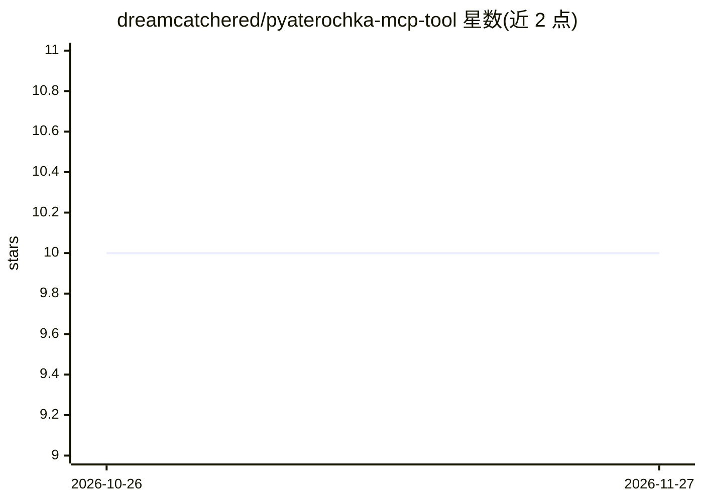

# dreamcatchered/pyaterochka-mcp-tool

⭐ 10 · Python · MIT · 推送 2026-08-23 · [GitHub](https://github.com/dreamcatchered/pyaterochka-mcp-tool) · 个人维护

**把 Pyaterochka 超市目录变成 LLM 可调用的 MCP 工具**

将 5ka.ru 公开商品目录封装为 12 个 MCP 工具（find_store、search_products、get_product_promotion 等），提供 stdio 与 HTTP 两种 MCP 服务器形态，可接入 Claude Desktop、Cursor、ChatGPT 等客户端；另附带工具调用链的 AI Telegram bot，可按地址/定位找店、按价格与促销筛选商品并发送图片。访问目录需 camoufox 浏览器模式或手动 cookies 绕过反爬；声明非官方、仅供教育用途。

## 筛选速览

| 维度 | 判定 | 备注 |
|---|---|---|
| AI 角色 | `ai-ecosystem` | LLM/agent 周边工具 |
| 许可风险 | `permissive` | MIT |
| 部署形态 | `library` | 以包/库形式分发 |
| 模型依赖 | local-ok | 支持本地模型 |
| 硬件要求 | — | 无带数字的原话,不猜 |
| 安装摩擦 | `low` | 无编译、无系统依赖或容器化 |
| 成熟度 | — | 结构信号不足 |

## 能力要点

- 12 个 MCP 工具：找店、分类、商品搜索、促销、营养信息、库存
- stdio 与 Streamable HTTP 双形态 MCP 服务器，可经 ngrok/cloudflared 隧道对外暴露
- Telegram AI agent bot：自动链式调用工具，支持 /model 热切换模型与多 LLM 备援
- OpenAI 兼容 API 接入任意提供商，含本地 vLLM/Ollama

## 适用场景

- 在 Claude Desktop 里用自然语言查询附近超市的商品价格和促销
- 通过 Telegram bot 发定位找优惠商品并收图
- 把 5ka.ru 目录作为远程 MCP 工具接入自己的 LLM 客户端

## 场景标签

`网页抓取` `聊天机器人` `浏览器自动化` · 领域:效率与自动化

## 证据(README 行号)

> L13: Проект превращает публичный каталог 5ka.ru в **инструменты (tools) для LLM**:
> L17: |🧩 **MCP stdio-сервер**|Подключается к Claude Desktop, Cursor, opencode и любому MCP-клиенту|

## 星数曲线

2026-10-26 10 → 2026-11-27 10（+0）

---
*卡片 v1 · prompt 1.4 · 生成 2026-11-19 · 置信度 mid · 依据 README sha `82b5829adfa0` · [字段定义](../../DATASET.md)*
