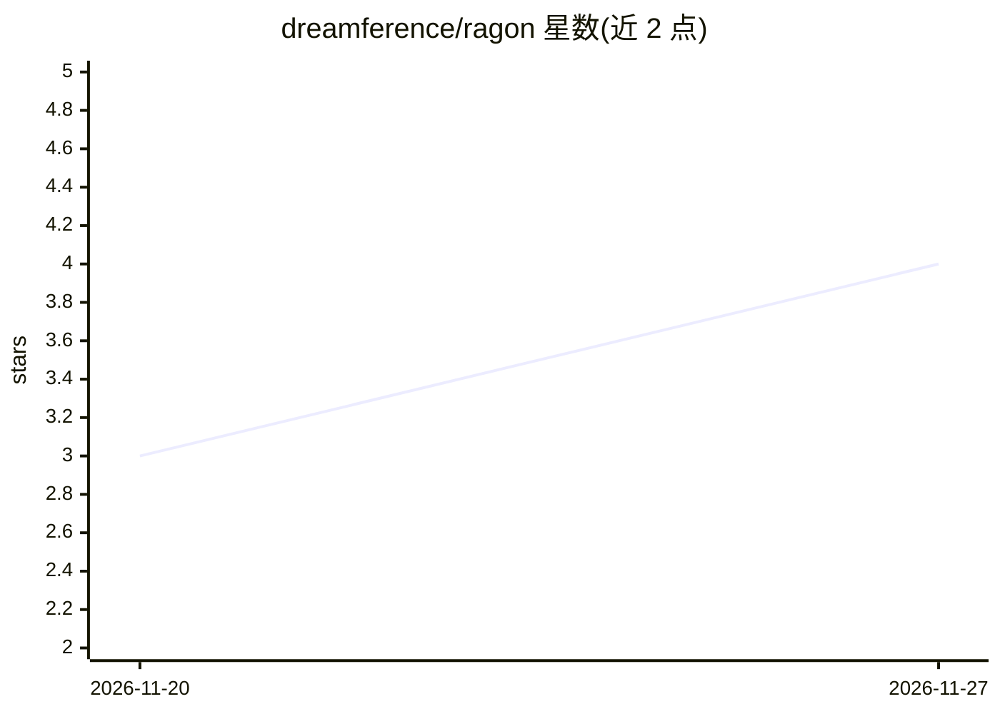

# dreamference/ragon

⭐ 4 · Python · AGPL-3.0 · 推送 2026-11-26 · [GitHub](https://github.com/dreamference/ragon) · 组织维护

**在 DGX Spark/GB10 机器上全本地运行 AI 编码代理与聊天桌面应用**

面向 NVIDIA DGX Spark 及各厂商 GB10 设备的本地 AI 编码套件，包含终端代理 ragon、浏览器问答界面与桌面应用，模型（Qwen3.8-27B NVFP4 格式，262K 上下文）在本地由 SGLang 引擎服务，无云、无账号、无遥测。提供一条命令安装脚本与 egress 审计命令证明网络行为，/airgapped 模式用内核网络命名空间断网；支持 Night Shift 队列任务（各自 git 分支）、代码索引、本地 SearXNG 搜索。同一模型服务也可驱动 Cline/Continue/OpenHands。许可证为 AGPL v3。

## 筛选速览

| 维度 | 判定 | 备注 |
|---|---|---|
| AI 角色 | `ai-native` | 本体是模型或模型工具 |
| 许可风险 | `viral` | AGPL-3.0 |
| 部署形态 | `desktop` | 安装包/桌面程序 |
| 模型依赖 | local-ok | 支持本地模型 |
| 硬件要求 | — | 无带数字的原话,不猜 |
| 安装摩擦 | `low` | 无编译、无系统依赖或容器化 |
| 成熟度 | — | 结构信号不足 |

## 能力要点

- 一条 curl 命令安装，模型权重约 20 GB 本地下载并校验 checksum
- ragon-admin audit egress 用 strace 列出全部网络连接以验证不外发
- /airgapped on 通过 Linux 网络命名空间强制断网
- 小模型起草 + 单次校验的投机解码，4 个代理并发无配额

## 适用场景

- 在不能上传代码的环境（客户项目、受监管数据）跑编码代理
- 离线/隔离网络下的本地代码问答与重构
- 睡前排队依赖升级任务，早上逐分支审查

## 场景标签

`编码 Agent` `推理引擎` · 领域:编码与开发

## 证据(README 行号)

> L5: **A fully local alternative to cloud coding agents.** A coding agent, a chat assistant and a desktop
> L146: |🖥️ **`ragon`, the terminal agent**|Reads your repository, runs commands and tests, edits code, and asks before an
> L174: **Is it really free?** Yes. Ragon is open source under the AGPL, and the model's weights are free.

## 星数曲线

2026-11-20 3 → 2026-11-27 4（+1）

---
*卡片 v1 · prompt 1.4 · 生成 2026-11-22 · 置信度 high · 依据 README sha `7ba32833e0ec` · [字段定义](../../DATASET.md)*
