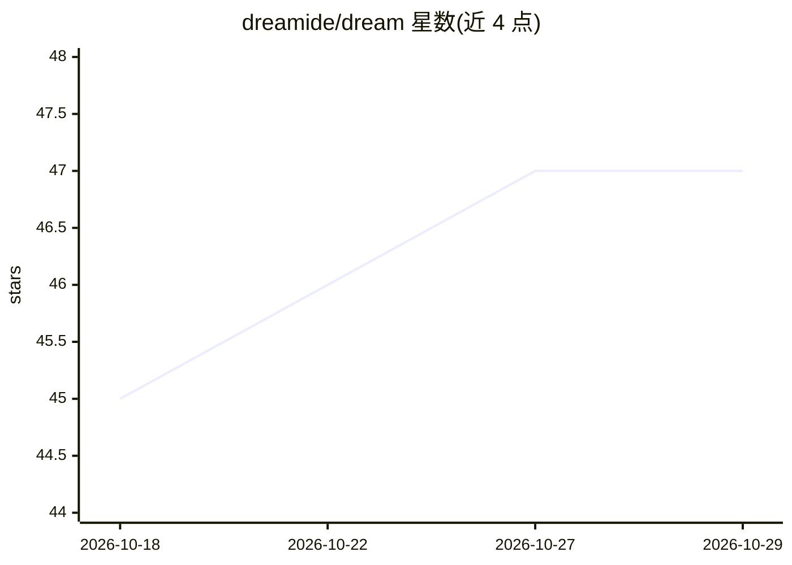

# dreamide/dream

⭐ 47 · TypeScript · MIT · 推送 2026-10-28 · [GitHub](https://github.com/dreamide/dream) · [官网](https://dreamide.dev) · 组织维护

**桌面 IDE，用于同时管理多个 AI 编码 agent**

Electron 桌面 IDE，面向使用 AI 编码 agent 的开发者：支持 Codex、Claude Code、OpenCode、Cursor Agent 等 agent CLI，可在多项目工作区中同时查看多个对话，内置 Git 工作流（分支/提交/推送/PR）、文件浏览与 diff 渲染、集成终端和浏览器预览面板。提供 Agent Skills 机制，按各 CLI 的发现方式加载技能文件夹，并可在设置中浏览、开关、脚手架生成技能。运行要求至少安装一个受支持的 agent CLI；提供 macOS/Windows/Linux 安装包，自动从 GitHub Releases 更新。

## 筛选速览

| 维度 | 判定 | 备注 |
|---|---|---|
| AI 角色 | `ai-ecosystem` | LLM/agent 周边工具 |
| 许可风险 | `permissive` | MIT |
| 部署形态 | `desktop` | 安装包/桌面程序 |
| 模型依赖 | — | README 未给出锁定关系 |
| 硬件要求 | — | 无带数字的原话,不猜 |
| 安装摩擦 | `low` | 无编译、无系统依赖或容器化 |
| 成熟度 | — | 结构信号不足 |

## 能力要点

- 多项目工作区与多对话同屏查看
- 支持 Codex / Claude Code / OpenCode / Cursor Agent 四种 agent CLI
- Git 分支、提交、推送与 PR 工作流
- Agent Skills：按各 CLI 原生方式发现技能文件夹，支持浏览与脚手架生成

## 适用场景

- 在一个桌面应用中并行使用多个 AI 编码 agent 处理不同项目
- 在 IDE 内完成 Git 提交、推送与 PR 流程
- 统一管理各 agent 的技能（Skills）

## 场景标签

`编码 Agent` · 领域:编码与开发

## 证据(README 行号)

> L3: Dream is a desktop IDE for working with multiple AI coding agents.
> L20: At least one supported agent CLI:

## 星数曲线

2026-10-18 45 → 2026-10-29 47（+2）

---
*卡片 v1 · prompt 1.4 · 生成 2026-10-25 · 置信度 mid · 依据 README sha `724aa07bb370` · [字段定义](../../DATASET.md)*
