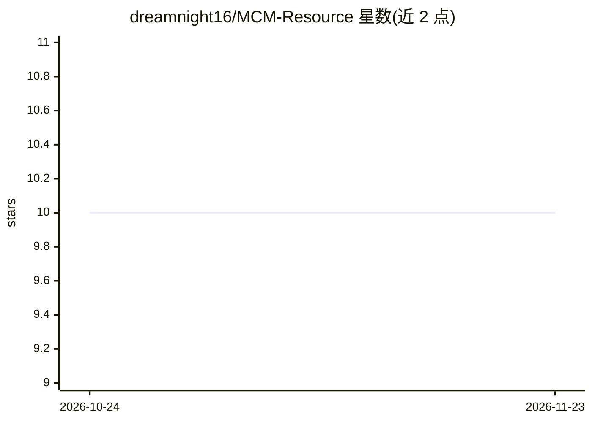

# dreamnight16/MCM-Resource

⭐ 10 · Python · MIT · 推送 2026-10-07 · [GitHub](https://github.com/dreamnight16/MCM-Resource) · 个人维护 · 中文 README

**数学建模竞赛知识库：模型文档+代码实现+赛事指南**

面向数学建模竞赛的知识库，以模型文档与可运行代码为核心、论文写作辅助为补充，覆盖 Python 与 MATLAB 两种实现。组织为 8 个模型大类（优化、评价、预测、分类、微分、统计、仿真、辅助）、27 个算法实现、4 个以上赛事指南，并提供 LaTeX 论文模板、样例数据与 67 个测试。含可选的 ai-tools 目录（阶段化提示词、Claude Code Skill、去 AI 化写作技巧、96 小时时间线清单），不使用 AI 服务时其余内容仍可完整工作。

## 筛选速览

| 维度 | 判定 | 备注 |
|---|---|---|
| AI 角色 | `ai-knowledge` | 知识聚合/清单类 |
| 许可风险 | `permissive` | MIT |
| 部署形态 | `library` | 以包/库形式分发 |
| 模型依赖 | — | README 未给出锁定关系 |
| 硬件要求 | — | 无带数字的原话,不猜 |
| 安装摩擦 | `low` | 无编译、无系统依赖或容器化 |
| 成熟度 | — | 结构信号不足 |

## 能力要点

- 8 大类模型文档，每篇含原理、适用场景、建模步骤、代码与论文呈现建议
- algorithms/ 下 Python+MATLAB 独立可运行实现，含内置示例数据
- 竞赛方法快速对照矩阵，按问题特征定位模型目录与阅读顺序
- 可选 ai-tools 目录：阶段化提示词模板与 Claude Code Skill

## 适用场景

- 备赛 MCM/ICM、CUMCM 等竞赛时按题型查找模型与代码
- 直接运行算法文件验证模型实现效果
- 用 LaTeX 模板快速搭建竞赛论文结构
- 合规使用 AI 工具辅助从选题到写作的全流程

## 场景标签

`教程课程` · 领域:学习与行业

## 证据(README 行号)

> L3: # Mathematical Modeling Contest Knowledge Base
> L39: The `ai-tools/` directory is optional. The model documentation, runnable
> L64: 1. **Install dependencies** → `pip install -r requirements.txt` (core deps: numpy, scipy, pandas, scikit-learn)

## 星数曲线

2026-10-24 10 → 2026-11-23 10（+0）

---
*卡片 v1 · prompt 1.4 · 生成 2026-11-19 · 置信度 high · 依据 README sha `1c6b55d3987e` · [字段定义](../../DATASET.md)*
